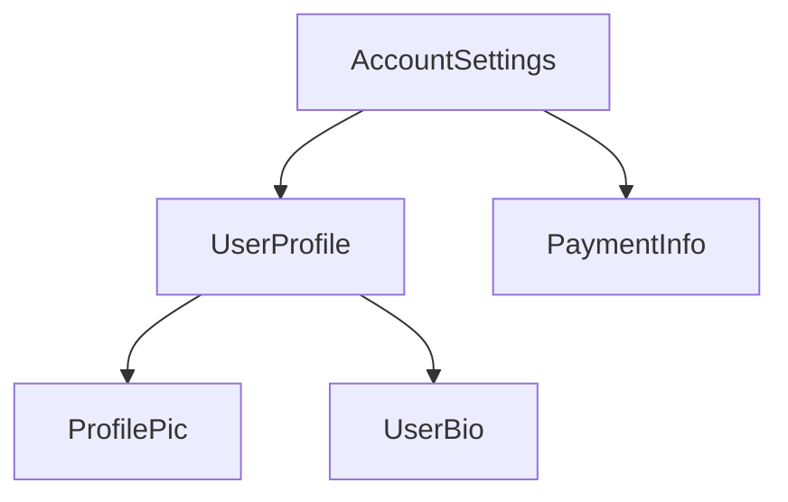

<docs-decorative-header title="Komponent anatomiyasi" imgSrc="adev/src/assets/images/components.svg"> <!-- markdownlint-disable-line -->
</docs-decorative-header>

TIP: Bu qoʻllanma siz [Asoslar qoʻllanmasini](essentials) allaqachon oʻqib chiqqan deb hisoblaydi. Agar Angular'da yangi boʻlsangiz, avval oʻshani oʻqing.

Har bir komponentda quyidagilar boʻlishi shart:

- Foydalanuvchi kiritmasiga ishlov berish va serverdan maʼlumot olish kabi _xatti-harakatlarga_ (behaviors) ega TypeScript klassi
- DOM'ga nima render qilinishini boshqaradigan HTML shablon
- Komponent HTML'da qanday ishlatilishini belgilaydigan [CSS selektori](https://developer.mozilla.org/docs/Learn/CSS/Building_blocks/Selectors)

Komponent uchun Angular'ga xos maʼlumotlarni TypeScript klassi ustiga `@Component` [dekoratorini](https://www.typescriptlang.org/docs/handbook/decorators.html) qoʻshish orqali berasiz:

```angular-ts {highlight: [1, 2, 3, 4]}
@Component({
  selector: 'profile-photo',
  template: ``,
})
export class ProfilePhoto {}
```

Angular shablonlarini yozish, jumladan maʼlumotlarni bogʻlash, hodisalarga ishlov berish va boshqaruv oqimi haqida toʻliq maʼlumot uchun [Shablonlar qoʻllanmasiga](guide/templates) qarang.

`@Component` dekoratoriga uzatiladigan obyekt komponentning **metamaʼlumotlari** (metadata) deb ataladi. Bunga `selector`, `template` va ushbu qoʻllanma davomida tavsiflangan boshqa xususiyatlar kiradi.

Komponentlar ixtiyoriy ravishda oʻsha komponentning DOM'iga qoʻllaniladigan CSS stillari roʻyxatini oʻz ichiga olishi mumkin:

```angular-ts {highlight: [4]}
@Component({
  selector: 'profile-photo',
  template: ``,
  styles: `
    img {
      border-radius: 50%;
    }
  `,
})
export class ProfilePhoto {}
```

Sukut boʻyicha komponent stillari faqat oʻsha komponent shablonida aniqlangan elementlarga taʼsir qiladi. Angular'ning stillar berishga yondashuvi haqida batafsil maʼlumot uchun [Komponentlarga stillar berish](guide/components/styling) boʻlimiga qarang.

Shuningdek, shablon va stillaringizni alohida fayllarda yozishni ham tanlashingiz mumkin:

```ts {highlight: [3,4]}
@Component({
  selector: 'profile-photo',
  templateUrl: 'profile-photo.html',
  styleUrl: 'profile-photo.css',
})
export class ProfilePhoto {}
```

Bu loyihangizda _koʻrinish_ (presentation) va _xatti-harakat_ (behavior) masalalarini bir-biridan ajratishga yordam beradi. Butun loyihangiz uchun bitta yondashuvni tanlashingiz yoki har bir komponent uchun qaysi birini ishlatishni alohida hal qilishingiz mumkin.

`templateUrl` ham, `styleUrl` ham komponent joylashgan katalogga nisbatan koʻrsatiladi.

## Komponentlardan foydalanish {#using-components}

### `@Component` dekoratoridagi importlar {#imports-in-the-component-decorator}

Komponent, [direktiva](guide/directives) yoki [pipe](guide/templates/pipes)'dan foydalanish uchun uni
`@Component` dekoratoridagi `imports` massiviga qoʻshishingiz kerak:

```ts
import {ProfilePhoto} from './profile-photo';

@Component({
  // Import the `ProfilePhoto` component in
  // order to use it in this component's template.
  imports: [ProfilePhoto],
  /* ... */
})
export class UserProfile {}
```

Sukut boʻyicha Angular komponentlari _standalone_ (mustaqil) boʻladi, yaʼni ularni toʻgʻridan-toʻgʻri boshqa komponentlarning `imports` massiviga qoʻshishingiz mumkin. Angular'ning oldingi versiyasida yaratilgan komponentlar esa `@Component` dekoratorida `standalone: false` ni koʻrsatgan boʻlishi mumkin. Bunday komponentlar uchun ularning oʻrniga komponent aniqlangan `NgModule`'ni import qilasiz. Batafsil maʼlumot uchun toʻliq [`NgModule` qoʻllanmasiga](guide/ngmodules/overview) qarang.

IMPORTANT: Angular'ning 19.0.0 dan oldingi versiyalarida `standalone` opsiyasi sukut boʻyicha `false` qiymatiga ega.

### Komponentlarni shablonda koʻrsatish {#showing-components-in-a-template}

Har bir komponent [CSS selektorini](https://developer.mozilla.org/docs/Learn/CSS/Building_blocks/Selectors) aniqlaydi:

```angular-ts {highlight: [2]}
@Component({
  selector: 'profile-photo',
  ...
})
export class ProfilePhoto { }
```

Angular qaysi turdagi selektorlarni qoʻllab-quvvatlashi va selektor tanlash boʻyicha tavsiyalar haqida batafsil maʼlumot uchun [Komponent selektorlari](guide/components/selectors) boʻlimiga qarang.

Komponentni _boshqa_ komponentlarning shablonida mos keluvchi HTML element yaratish orqali koʻrsatasiz:

```angular-ts {highlight: [8]}
@Component({
  selector: 'profile-photo',
})
export class ProfilePhoto {}

@Component({
  imports: [ProfilePhoto],
  template: `<profile-photo />`,
})
export class UserProfile {}
```

Angular duch kelgan har bir mos keluvchi HTML element uchun komponentning nusxasini (instance) yaratadi. Komponent selektoriga mos keladigan DOM elementi oʻsha komponentning **host elementi** deb ataladi. Komponent shablonining mazmuni uning host elementi ichida render qilinadi.

Komponent tomonidan render qilingan, oʻsha komponent shabloniga mos keladigan DOM
komponentning **view**'i deb ataladi.

Komponentlarni shu tarzda birlashtirganda, **Angular ilovangizni komponentlar daraxti deb tasavvur qilishingiz mumkin**.



Bu daraxt tuzilmasi Angular'ning boshqa bir qancha tushunchalarini, jumladan [bogʻliqliklarni inyeksiya qilish](guide/di) va [bola soʻrovlarini](guide/components/queries) tushunish uchun muhim.
