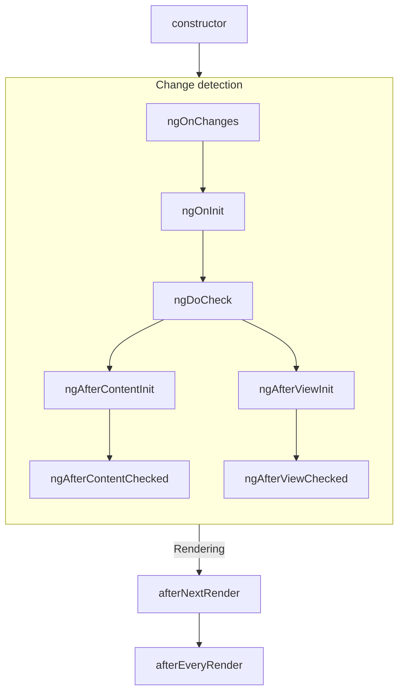
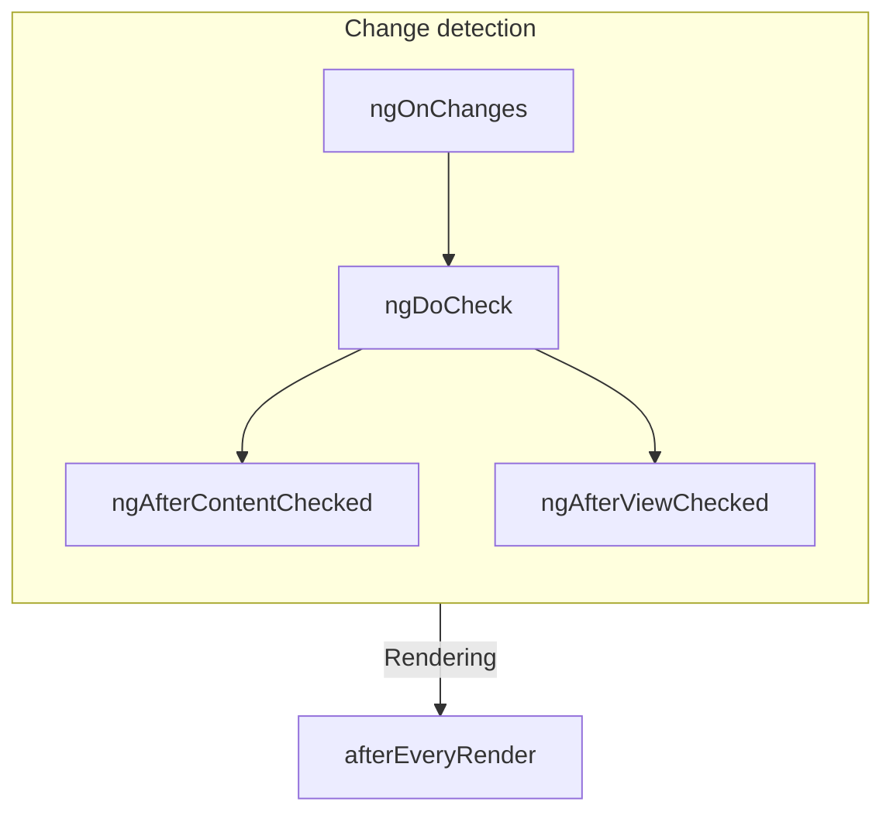

# Komponent hayot sikli

TIP: Bu qoʻllanma siz [Asoslar qoʻllanmasini](essentials) allaqachon oʻqigansiz deb hisoblaydi. Angular'da yangi boʻlsangiz, avval oʻshani oʻqing.

Komponentning **hayot sikli** (lifecycle) — komponent yaratilishidan uning yoʻq qilinishigacha sodir boʻladigan qadamlar ketma-ketligi. Har bir qadam Angular'ning komponentlarni render qilish va vaqt oʻtishi bilan ularni yangilanishlar uchun tekshirish jarayonining alohida qismini ifodalaydi.

Komponentlaringizda shu qadamlar davomida kod bajarish uchun **hayot sikli hook'larini** (lifecycle hooks) amalga oshirishingiz mumkin. Muayyan komponent nusxasiga tegishli hayot sikli hook'lari komponent klassingizdagi metodlar sifatida amalga oshiriladi. Angular ilovasiga bir butun sifatida tegishli hayot sikli hook'lari callback qabul qiluvchi funksiyalar sifatida amalga oshiriladi.

Komponentning hayot sikli Angular komponentlaringizni vaqt oʻtishi bilan oʻzgarishlar uchun qanday tekshirishi bilan chambarchas bogʻliq. Bu hayot siklini tushunish uchun Angular ilova daraxtingizni yuqoridan pastga qarab aylanib, shablon bogʻlashlarini oʻzgarishlar uchun tekshirishini bilishingiz kifoya. Quyida tavsiflangan hayot sikli hook'lari Angular shu aylanishni bajarayotgan paytda ishga tushadi. Bu aylanish har bir komponentga aynan bir marta tashrif buyuradi, shuning uchun jarayon oʻrtasida qoʻshimcha holat oʻzgarishlarini kiritishdan doimo qochishingiz kerak.

## Qisqacha mazmun {#summary}

<div class="docs-table docs-scroll-track-transparent">
  <table>
    <tr>
      <td><strong>Bosqich</strong></td>
      <td><strong>Metod</strong></td>
      <td><strong>Qisqacha mazmun</strong></td>
    </tr>
    <tr>
      <td>Yaratish</td>
      <td><code>constructor</code></td>
      <td>
        <a href="https://developer.mozilla.org/docs/Web/JavaScript/Reference/Classes/constructor" target="_blank">
          Standart JavaScript klass konstruktori
        </a>. Angular komponent nusxasini yaratganda ishga tushadi.
      </td>
    </tr>
    <tr>
      <td rowspan="7">Oʻzgarishlarni<br>aniqlash</td>
      <td><code>ngOnInit</code>
      </td>
      <td>Angular komponentning barcha input'larini ishga tushirgandan keyin bir marta ishga tushadi.</td>
    </tr>
    <tr>
      <td><code>ngOnChanges</code></td>
      <td>Komponent input'lari har safar oʻzgarganda ishga tushadi.</td>
    </tr>
    <tr>
      <td><code>ngDoCheck</code></td>
      <td>Bu komponent har safar oʻzgarishlar uchun tekshirilganda ishga tushadi.</td>
    </tr>
    <tr>
      <td><code>ngAfterContentInit</code></td>
      <td>Komponentning <em>kontenti</em> ishga tushirilgandan keyin bir marta ishga tushadi.</td>
    </tr>
    <tr>
      <td><code>ngAfterContentChecked</code></td>
      <td>Bu komponentning kontenti har safar oʻzgarishlar uchun tekshirilganda ishga tushadi.</td>
    </tr>
    <tr>
      <td><code>ngAfterViewInit</code></td>
      <td>Komponentning <em>view</em>'i ishga tushirilgandan keyin bir marta ishga tushadi.</td>
    </tr>
    <tr>
      <td><code>ngAfterViewChecked</code></td>
      <td>Komponentning view'i har safar oʻzgarishlar uchun tekshirilganda ishga tushadi.</td>
    </tr>
    <tr>
      <td rowspan="2">Render qilish</td>
      <td><code>afterNextRender</code></td>
      <td><strong>Barcha</strong> komponentlar DOM'ga keyingi safar render qilinganda bir marta ishga tushadi.</td>
    </tr>
    <tr>
      <td><code>afterEveryRender</code></td>
      <td><strong>Barcha</strong> komponentlar DOM'ga har safar render qilinganda ishga tushadi.</td>
    </tr>
    <tr>
      <td>Yoʻq qilish</td>
      <td><code>ngOnDestroy</code></td>
      <td>Komponent yoʻq qilinishidan oldin bir marta ishga tushadi.</td>
    </tr>
  </table>
</div>

### ngOnInit {#ngoninit}

`ngOnInit` metodi Angular komponentning barcha input'larini ularning boshlangʻich qiymatlari bilan ishga tushirgandan keyin ishga tushadi. Komponentning `ngOnInit` metodi aynan bir marta ishga tushadi.

Bu qadam komponentning oʻz shabloni ishga tushirilishidan _oldin_ sodir boʻladi. Bu komponent holatini uning boshlangʻich input qiymatlariga asoslanib yangilashingiz mumkinligini anglatadi.

### ngOnChanges {#ngonchanges}

`ngOnChanges` metodi komponentning har qanday input'lari oʻzgargandan keyin ishga tushadi.

Bu qadam komponentning oʻz shabloni tekshirilishidan _oldin_ sodir boʻladi. Bu komponent holatini uning boshlangʻich input qiymatlariga asoslanib yangilashingiz mumkinligini anglatadi.

Ishga tushirish davomida birinchi `ngOnChanges` `ngOnInit`'dan oldin ishga tushadi.

#### Oʻzgarishlarni tekshirish {#inspecting-changes}

`ngOnChanges` metodi bitta `SimpleChanges` argumentini qabul qiladi. Bu obyekt har bir komponent input nomini `SimpleChange` obyektiga moslashtiruvchi [`Record`](https://www.typescriptlang.org/docs/handbook/utility-types.html#recordkeys-type) hisoblanadi. Har bir `SimpleChange` input'ning oldingi qiymatini, joriy qiymatini va bu input'ning birinchi marta oʻzgarishi ekanligini koʻrsatuvchi bayroqni oʻz ichiga oladi.

Kuchliroq tur tekshiruvi uchun ixtiyoriy ravishda joriy klassni yoki `this`'ni birinchi generik argument sifatida uzatishingiz mumkin.

```ts
@Component({/* ... */})
export class UserProfile {
  name = input('');

  ngOnChanges(changes: SimpleChanges<UserProfile>) {
    if (changes.name) {
      console.log(`Previous: ${changes.name.previousValue}`);
      console.log(`Current: ${changes.name.currentValue}`);
      console.log(`Is first ${changes.name.firstChange}`);
    }
  }
}
```

Agar biror input xususiyati uchun `alias` bersangiz, `SimpleChanges` Record'i kalit sifatida taxallusni emas, baribir TypeScript xususiyat nomini ishlatadi.

### ngOnDestroy {#ngondestroy}

`ngOnDestroy` metodi komponent yoʻq qilinishidan sal oldin bir marta ishga tushadi. Angular komponent sahifada endi koʻrsatilmaganda, masalan, `@if` bilan yashirilganda yoki boshqa sahifaga oʻtilganda uni yoʻq qiladi.

#### DestroyRef {#destroyref}

`ngOnDestroy` metodiga muqobil sifatida `DestroyRef` nusxasini inyeksiya qilishingiz mumkin. `DestroyRef`'ning `onDestroy` metodini chaqirib, komponent yoʻq qilinganda chaqiriladigan callback'ni roʻyxatdan oʻtkazishingiz mumkin.

```ts
@Component({/* ... */})
export class UserProfile {
  constructor() {
    inject(DestroyRef).onDestroy(() => {
      console.log('UserProfile destruction');
    });
  }
}
```

`DestroyRef` nusxasini komponentingizdan tashqaridagi funksiyalar yoki klasslarga uzatishingiz mumkin. Komponent yoʻq qilinganda qandaydir tozalash ishlarini bajarishi kerak boʻlgan boshqa kodingiz boʻlsa, shu usuldan foydalaning.

Shuningdek, barcha tozalash kodini `ngOnDestroy` metodiga joylash oʻrniga, sozlash kodini tozalash kodiga yaqin saqlash uchun ham `DestroyRef`'dan foydalanishingiz mumkin.

##### Nusxa yoʻq qilinganini aniqlash {#detecting-instance-destruction}

`DestroyRef` berilgan nusxa allaqachon yoʻq qilinganini tekshirish imkonini beruvchi `destroyed` xususiyatini taqdim etadi. Bu yoʻq qilingan komponentlar ustida amallar bajarishdan qochish uchun, ayniqsa kechiktirilgan yoki asinxron logika bilan ishlashda foydali.

`destroyRef.destroyed`'ni tekshirib, nusxa tozalangandan keyin kod bajarilishining oldini olishingiz va `NG0911: View has already been destroyed.` kabi ehtimoliy xatolardan qochishingiz mumkin.

### ngDoCheck {#ngdocheck}

`ngDoCheck` metodi Angular har safar komponent shablonini oʻzgarishlar uchun tekshirishidan oldin ishga tushadi.

Bu hayot sikli hook'idan Angular'ning odatiy oʻzgarishlarni aniqlashidan tashqaridagi holat oʻzgarishlarini qoʻlda tekshirish va komponent holatini qoʻlda yangilash uchun foydalanishingiz mumkin.

Bu metod juda tez-tez ishga tushadi va sahifangiz unumdorligiga sezilarli taʼsir qilishi mumkin. Imkon qadar bu hook'ni aniqlashdan qoching va undan faqat boshqa yoʻl boʻlmaganda foydalaning.

Ishga tushirish davomida birinchi `ngDoCheck` `ngOnInit`'dan keyin ishga tushadi.

### ngAfterContentInit {#ngaftercontentinit}

`ngAfterContentInit` metodi komponent ichiga joylashtirilgan barcha bolalar (uning _kontenti_) ishga tushirilgandan keyin bir marta ishga tushadi.

Bu hayot sikli hook'idan [kontent soʻrovlari](guide/components/queries#content-queries) natijalarini oʻqish uchun foydalanishingiz mumkin. Bu soʻrovlarning ishga tushirilgan holatiga murojaat qila olsangiz-da, bu metodda biror holatni oʻzgartirishga urinish [ExpressionChangedAfterItHasBeenCheckedError](errors/NG0100) xatosiga olib keladi

### ngAfterContentChecked {#ngaftercontentchecked}

`ngAfterContentChecked` metodi komponent ichiga joylashtirilgan bolalar (uning _kontenti_) har safar oʻzgarishlar uchun tekshirilganda ishga tushadi.

Bu metod juda tez-tez ishga tushadi va sahifangiz unumdorligiga sezilarli taʼsir qilishi mumkin. Imkon qadar bu hook'ni aniqlashdan qoching va undan faqat boshqa yoʻl boʻlmaganda foydalaning.

Bu yerda [kontent soʻrovlarining](guide/components/queries#content-queries) yangilangan holatiga murojaat qila olsangiz-da, bu metodda biror holatni oʻzgartirishga urinish [ExpressionChangedAfterItHasBeenCheckedError](errors/NG0100) xatosiga olib keladi.

### ngAfterViewInit {#ngafterviewinit}

`ngAfterViewInit` metodi komponent shablonidagi barcha bolalar (uning _view_'i) ishga tushirilgandan keyin bir marta ishga tushadi.

Bu hayot sikli hook'idan [view soʻrovlari](guide/components/queries#view-queries) natijalarini oʻqish uchun foydalanishingiz mumkin. Bu soʻrovlarning ishga tushirilgan holatiga murojaat qila olsangiz-da, bu metodda biror holatni oʻzgartirishga urinish [ExpressionChangedAfterItHasBeenCheckedError](errors/NG0100) xatosiga olib keladi

### ngAfterViewChecked {#ngafterviewchecked}

`ngAfterViewChecked` metodi komponent shablonidagi bolalar (uning _view_'i) har safar oʻzgarishlar uchun tekshirilganda ishga tushadi.

Bu metod juda tez-tez ishga tushadi va sahifangiz unumdorligiga sezilarli taʼsir qilishi mumkin. Imkon qadar bu hook'ni aniqlashdan qoching va undan faqat boshqa yoʻl boʻlmaganda foydalaning.

Bu yerda [view soʻrovlarining](guide/components/queries#view-queries) yangilangan holatiga murojaat qila olsangiz-da, bu metodda biror holatni oʻzgartirishga urinish [ExpressionChangedAfterItHasBeenCheckedError](errors/NG0100) xatosiga olib keladi.

### afterEveryRender va afterNextRender {#aftereveryrender-and-afternextrender}

`afterEveryRender` va `afterNextRender` funksiyalari Angular sahifadagi _barcha komponentlarni_ DOM'ga render qilishni tugatgandan keyin chaqiriladigan **render callback**'ni roʻyxatdan oʻtkazish imkonini beradi.

Bu funksiyalar ushbu qoʻllanmada tavsiflangan boshqa hayot sikli hook'laridan farq qiladi. Ular klass metodi emas, balki callback qabul qiluvchi mustaqil funksiyalardir. Render callback'larining bajarilishi muayyan komponent nusxasiga bogʻlanmagan, aksincha, bu ilova miqyosidagi hook hisoblanadi.

`afterEveryRender` va `afterNextRender` [inyeksiya kontekstida](guide/di/dependency-injection-context), odatda komponent konstruktorida chaqirilishi kerak.

Render callback'laridan qoʻlda DOM amallarini bajarish uchun foydalanishingiz mumkin. Angular'da DOM bilan ishlash boʻyicha koʻrsatmalar uchun [DOM API'laridan foydalanish](guide/components/dom-apis) boʻlimiga qarang.

Render callback'lari server tomonida render qilish yoki build vaqtida oldindan render qilish (pre-rendering) davomida ishga tushmaydi.

#### after\*Render bosqichlari {#afterrender-phases}

`afterEveryRender` yoki `afterNextRender` ishlatganda ixtiyoriy ravishda ishni bosqichlarga (phases) boʻlishingiz mumkin. Bosqich DOM amallarining ketma-ketligini boshqarish imkonini beradi va [layout thrashing'ni](https://web.dev/avoid-large-complex-layouts-and-layout-thrashing) kamaytirish uchun _yozish_ amallarini _oʻqish_ amallaridan oldin tartiblash imkonini beradi. Bosqichlar oʻrtasida maʼlumot almashish uchun bosqich funksiyasi keyingi bosqichda murojaat qilish mumkin boʻlgan natija qiymatini qaytarishi mumkin.

```ts
import {Component, ElementRef, afterNextRender} from '@angular/core';

@Component(/* ... */)
export class UserProfile {
  private prevPadding = 0;
  private elementHeight = 0;

  constructor() {
    const elementRef = inject(ElementRef);
    const nativeElement = elementRef.nativeElement;

    afterNextRender({
      // Use the `Write` phase to write to a geometric property.
      write: () => {
        const padding = computePadding();
        const changed = padding !== this.prevPadding;
        if (changed) {
          nativeElement.style.padding = padding;
        }
        return changed; // Communicate whether anything changed to the read phase.
      },

      // Use the `Read` phase to read geometric properties after all writes have occurred.
      read: (didWrite) => {
        if (didWrite) {
          this.elementHeight = nativeElement.getBoundingClientRect().height;
        }
      },
    });
  }
}
```

Toʻrtta bosqich mavjud boʻlib, ular quyidagi tartibda ishga tushadi:

| Bosqich          | Tavsif                                                                                                                                                                                                            |
| ---------------- | ----------------------------------------------------------------------------------------------------------------------------------------------------------------------------------------------------------------- |
| `earlyRead`      | Bu bosqichdan keyingi hisob-kitoblar uchun qatʼiy zarur boʻlgan, layout'ga taʼsir qiluvchi DOM xususiyatlari va stillarini oʻqish uchun foydalaning. Imkon boʻlsa bu bosqichdan qoching, `write` va `read` bosqichlarini afzal koʻring. |
| `write`          | Bu bosqichdan layout'ga taʼsir qiluvchi DOM xususiyatlari va stillarini yozish uchun foydalaning.                                                                                                                 |
| `mixedReadWrite` | Sukut boʻyicha bosqich. Layout'ga taʼsir qiluvchi xususiyatlar va stillarni ham oʻqish, ham yozish kerak boʻlgan har qanday amallar uchun foydalaning. Imkon boʻlsa bu bosqichdan qoching, aniq `write` va `read` bosqichlarini afzal koʻring. |
| `read`           | Bu bosqichdan layout'ga taʼsir qiluvchi har qanday DOM xususiyatlarini oʻqish uchun foydalaning.                                                                                                                  |

## Hayot sikli interfeyslari {#lifecycle-interfaces}

Angular har bir hayot sikli metodi uchun TypeScript interfeysini taqdim etadi. Amalga oshirishingizda imlo xatolari yoʻqligiga ishonch hosil qilish uchun ixtiyoriy ravishda bu interfeyslarni import qilib, `implement` qilishingiz mumkin.

Har bir interfeys `ng` prefiksisiz tegishli metod bilan bir xil nomga ega. Masalan, `ngOnInit` uchun interfeys — `OnInit`.

```ts
@Component({/* ... */})
export class UserProfile implements OnInit {
  ngOnInit() {
    /* ... */
  }
}
```

## Bajarilish tartibi {#execution-order}

Quyidagi diagrammalar Angular hayot sikli hook'larining bajarilish tartibini koʻrsatadi.

### Ishga tushirish davomida {#during-initialization}



### Keyingi yangilanishlar {#subsequent-updates}



### Direktivalar bilan tartiblash {#ordering-with-directives}

Shablonda yoki `hostDirectives` xususiyati orqali komponent bilan bir xil elementga bir yoki bir nechta direktiva qoʻyganingizda, freymvork bitta elementdagi komponent va direktivalar oʻrtasida berilgan hayot sikli hook'ining hech qanday tartibini kafolatlamaydi. Kuzatilgan tartibga hech qachon tayanmang, chunki u Angular'ning keyingi versiyalarida oʻzgarishi mumkin.
