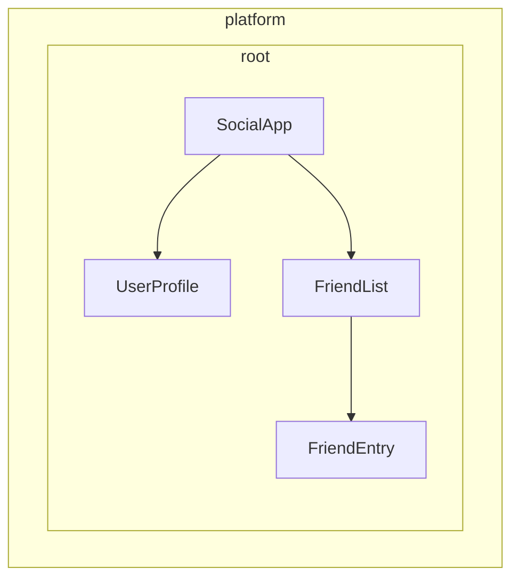

# Bogʻliqlik provider'larini aniqlash

Angular servislarni inyeksiya uchun mavjud qilishning ikki usulini taqdim etadi:

1. **Avtomatik taqdim etish** - `@Injectable` dekoratorida `providedIn`'dan, [`@Service`](guide/di/creating-and-using-services#using-the-service-vs-injectable-decorator) dekoratoridan foydalanish yoki `InjectionToken` konfiguratsiyasida fabrika (factory) berish orqali
2. **Qoʻlda taqdim etish** - komponentlar, direktivalar, marshrutlar yoki ilova konfiguratsiyasidagi `providers` massividan foydalanish orqali

[Oldingi qoʻllanmada](/guide/di/creating-and-using-services) siz eng keng tarqalgan holatlarni qamrab oluvchi `providedIn: 'root'` yordamida servislarni qanday yaratishni oʻrgandingiz. Bu qoʻllanma provider'larni avtomatik va qoʻlda sozlashning qoʻshimcha namunalarini koʻrib chiqadi.

## Klass boʻlmagan bogʻliqliklarni avtomatik taqdim etish {#automatic-provision-for-non-class-dependencies}

`providedIn: 'root'` bilan `@Injectable` dekoratori servislar (klasslar) uchun juda yaxshi ishlasa-da, sizga boshqa turdagi qiymatlarni - konfiguratsiya obyektlari, funksiyalar yoki primitiv qiymatlarni - global tarzda taqdim etish kerak boʻlishi mumkin. Angular bu maqsadda `InjectionToken`'ni taqdim etadi.

### InjectionToken nima? {#what-is-an-injectiontoken}

`InjectionToken` - Angular'ning bogʻliqliklarni inyeksiya qilish tizimi inyeksiya uchun qiymatlarni yagona tarzda identifikatsiya qilishda foydalanadigan obyekt. Uni Angular'ning DI tizimida istalgan turdagi qiymatni saqlash va olish imkonini beruvchi maxsus kalit deb tasavvur qiling:

```ts
import {InjectionToken} from '@angular/core';

// Create a token for a string value
export const API_URL = new InjectionToken<string>('api.url');

// Create a token for a function
export const LOGGER = new InjectionToken<(msg: string) => void>('logger.function');

// Create a token for a complex type
export interface Config {
  apiUrl: string;
  timeout: number;
}
export const CONFIG_TOKEN = new InjectionToken<Config>('app.config');
```

NOTE: Satr parametri (masalan, `'api.url'`) faqat debugging uchun moʻljallangan tavsif — Angular tokenlarni bu satr boʻyicha emas, balki obyekt havolasi (reference) boʻyicha identifikatsiya qiladi.

### `providedIn: 'root'` bilan InjectionToken {#injectiontoken-with-providedin-root}

`factory`'ga ega `InjectionToken` sukut boʻyicha `providedIn: 'root'` kabi ishlaydi (lekin buni `providedIn` xususiyati orqali oʻzgartirish mumkin).

```ts {header: "/app/config.token.ts"}
import {InjectionToken} from '@angular/core';

export interface AppConfig {
  apiUrl: string;
  version: string;
  features: Record<string, boolean>;
}

// Globally available configuration using providedIn
export const APP_CONFIG = new InjectionToken<AppConfig>('app.config', {
  providedIn: 'root',
  factory: () => ({
    apiUrl: 'https://api.example.com',
    version: '1.0.0',
    features: {
      darkMode: true,
      analytics: false,
    },
  }),
});

// No need to add to providers array - available everywhere!
@Component({
  selector: 'app-header',
  template: `<h1>Version: {{ config.version }}</h1>`,
})
export class Header {
  config = inject(APP_CONFIG); // Automatically available
}
```

### InjectionToken'ni fabrika funksiyalari bilan qachon ishlatish kerak {#when-to-use-injectiontoken-with-factory-functions}

Fabrika funksiyali InjectionToken klassdan foydalana olmaydigan, lekin bogʻliqliklarni global tarzda taqdim etishingiz kerak boʻlgan holatlar uchun ideal:

```ts {header: "/app/logger.token.ts"}
import {InjectionToken, inject} from '@angular/core';
import {APP_CONFIG} from './config.token';

// Logger function type
export type LoggerFn = (level: string, message: string) => void;

// Global logger function with dependencies
export const LOGGER_FN = new InjectionToken<LoggerFn>('logger.function', {
  providedIn: 'root',
  factory: () => {
    const config = inject(APP_CONFIG);

    return (level: string, message: string) => {
      if (config.features.logging !== false) {
        console[level](`[${new Date().toISOString()}] ${message}`);
      }
    };
  },
});
```

```ts {header: "/app/storage.token.ts"}
// Providing browser APIs as tokens
export const LOCAL_STORAGE = new InjectionToken<Storage>('localStorage', {
  // providedIn: 'root' is configured as the default
  factory: () => window.localStorage,
});

export const SESSION_STORAGE = new InjectionToken<Storage>('sessionStorage', {
  providedIn: 'root',
  factory: () => window.sessionStorage,
});
```

```ts {header: "/app/feature-flags.token.ts"}
// Complex configuration with runtime logic
export const FEATURE_FLAGS = new InjectionToken<Map<string, boolean>>('feature.flags', {
  providedIn: 'root',
  factory: () => {
    const flags = new Map<string, boolean>();

    // Parse from environment or URL params
    const urlParams = new URLSearchParams(window.location.search);
    const enableBeta = urlParams.get('beta') === 'true';

    flags.set('betaFeatures', enableBeta);
    flags.set('darkMode', true);
    flags.set('newDashboard', false);

    return flags;
  },
});
```

Bu yondashuv bir nechta afzallik beradi:

- **Provider'ni qoʻlda sozlash talab qilinmaydi** - servislar uchun `providedIn: 'root'` kabi ishlaydi
- **Tree-shakeable** - faqat haqiqatan ishlatilganda bundle'ga kiritiladi
- **Tip jihatidan xavfsiz** - klass boʻlmagan qiymatlar uchun toʻliq TypeScript qoʻllab-quvvatlashi
- **Boshqa bogʻliqliklarni inyeksiya qila oladi** - fabrika funksiyalari boshqa servislarga kirish uchun `inject()`'dan foydalanishi mumkin

## Provider'ni qoʻlda sozlashni tushunish {#understanding-manual-provider-configuration}

`providedIn: 'root'` beradiganidan koʻproq nazorat kerak boʻlganda, provider'larni qoʻlda sozlashingiz mumkin. `providers` massivi orqali qoʻlda sozlash quyidagi holatlarda foydali:

1. **Servisda `providedIn` yoʻq** - avtomatik taqdim etilmaydigan servislar qoʻlda taqdim etilishi shart
2. **Yangi nusxa (instance) kerak** - umumiy nusxadan foydalanish oʻrniga komponent/direktiva darajasida alohida nusxa yaratish uchun
3. **Ishga tushirish vaqtidagi (runtime) konfiguratsiya kerak** - servis xatti-harakati ishga tushirish vaqtidagi qiymatlarga bogʻliq boʻlganda
4. **Klass boʻlmagan qiymatlarni taqdim etayotganingizda** - konfiguratsiya obyektlari, funksiyalar yoki primitiv qiymatlar

### Misol: `providedIn`'siz servis {#example-service-without-providedin}

```ts
import {Injectable, Component, inject} from '@angular/core';

// Service without providedIn
@Injectable()
export class LocalDataStore {
  private data: string[] = [];

  addData(item: string) {
    this.data.push(item);
  }
}

// Component must provide it
@Component({
  selector: 'app-example',
  // A provider is required here because the `LocalDataStore` service has no providedIn.
  providers: [LocalDataStore],
  template: `...`,
})
export class Example {
  dataStore = inject(LocalDataStore);
}
```

### Misol: komponentga xos nusxalar yaratish {#example-creating-component-specific-instances}

`providedIn: 'root'` bilan taqdim etilgan servislarni komponent darajasida qayta aniqlash (override) mumkin. Bu servis nusxasini komponentning hayotiga bogʻlaydi. Natijada, komponent yoʻq qilinganda taqdim etilgan servis ham yoʻq qilinadi.

```ts
import {Injectable, Component, inject} from '@angular/core';

@Injectable({providedIn: 'root'})
export class DataStore {
  private data: ListItem[] = [];
}

// This component gets its own instance
@Component({
  selector: 'app-isolated',
  // Creates new instance of `DataStore` rather than using the root-provided instance.
  providers: [DataStore],
  template: `...`,
})
export class Isolated {
  dataStore = inject(DataStore); // Component-specific instance
}
```

## Angular'da injector ierarxiyasi {#injector-hierarchy-in-angular}

Angular'ning bogʻliqliklarni inyeksiya qilish tizimi ierarxik. Komponent bogʻliqlikni soʻraganda, Angular shu komponentning injector'idan boshlaydi va oʻsha bogʻliqlik uchun provider topilmaguncha daraxt boʻylab yuqoriga koʻtariladi. Ilova daraxtingizdagi har bir komponent oʻz injector'iga ega boʻlishi mumkin va bu injector'lar komponent daraxtingizni aks ettiruvchi ierarxiyani hosil qiladi.

Bu ierarxiya quyidagilarga imkon beradi:

- **Qamrovli (scoped) nusxalar**: ilovangizning turli qismlari bir xil servisning turli nusxalariga ega boʻlishi mumkin
- **Qayta aniqlash (override) imkoniyati**: bola komponentlar ota komponentlardagi provider'larni qayta aniqlashi mumkin
- **Xotira samaradorligi**: servislar faqat kerak boʻlgan joyda yaratiladi

Angular'da komponent yoki direktivaga ega har qanday element oʻzining barcha avlodlariga qiymatlar taqdim etishi mumkin.



Yuqoridagi misolda:

1. `SocialApp` `UserProfile` va `FriendList` uchun qiymatlar taqdim etishi mumkin
2. `FriendList` `FriendEntry`'ga inyeksiya uchun qiymatlar taqdim etishi mumkin, lekin `UserProfile`'ga inyeksiya uchun qiymatlar taqdim eta olmaydi, chunki u daraxtning shu qismiga kirmaydi

## Provider'ni eʼlon qilish {#declaring-a-provider}

Angular'ning bogʻliqliklarni inyeksiya qilish tizimini hash map yoki lugʻat deb tasavvur qiling. Har bir provider konfiguratsiya obyekti kalit-qiymat juftligini belgilaydi:

- **Kalit (provider identifikatori)**: bogʻliqlikni soʻrash uchun foydalanadigan yagona identifikator
- **Qiymat**: oʻsha token soʻralganda Angular qaytarishi kerak boʻlgan narsa

Bogʻliqliklarni qoʻlda taqdim etganda, siz odatda quyidagi qisqa sintaksisni koʻrasiz:

```angular-ts
import {Component} from '@angular/core';
import {LocalService} from './local-service';

@Component({
  selector: 'app-example',
  providers: [LocalService], // Service without providedIn
})
export class Example {}
```

Bu aslida yanada batafsil provider konfiguratsiyasining qisqa yozuvi:

```ts
{
  // This is the shorthand version
  providers: [LocalService],

  // This is the full version
  providers: [
    { provide: LocalService, useClass: LocalService }
  ]
}
```

### Provider konfiguratsiya obyekti {#provider-configuration-object}

Har bir provider konfiguratsiya obyekti ikki asosiy qismdan iborat:

1. **Provider identifikatori**: Angular bogʻliqlikni olish uchun foydalanadigan yagona kalit (`provide` xususiyati orqali beriladi)
2. **Qiymat**: Angular olib kelishini istagan haqiqiy bogʻliqlik; kerakli turga qarab turli kalitlar bilan sozlanadi:
   - `useClass` - JavaScript klassini taqdim etadi
   - `useValue` - statik qiymatni taqdim etadi
   - `useFactory` - qiymatni qaytaruvchi fabrika funksiyasini taqdim etadi
   - `useExisting` - mavjud provider'ga taxallus (alias) taqdim etadi

### Provider identifikatorlari {#provider-identifiers}

Provider identifikatorlari Angular'ning bogʻliqliklarni inyeksiya qilish (DI) tizimiga bogʻliqlikni yagona ID orqali olish imkonini beradi. Provider identifikatorlarini ikki yoʻl bilan hosil qilishingiz mumkin:

1. [Klass nomlari](#class-names)
2. [Inyeksiya tokenlari](#injection-tokens)

#### Klass nomlari {#class-names}

Klass nomlari import qilingan klassning oʻzini bevosita identifikator sifatida ishlatadi:

```angular-ts
import {Component} from '@angular/core';
import {LocalService} from './local-service';

@Component({
  selector: 'app-example',
  providers: [{provide: LocalService, useClass: LocalService}],
})
export class Example {
  /* ... */
}
```

Klass identifikator ham, realizatsiya ham vazifasini bajaradi, shuning uchun Angular `providers: [LocalService]` qisqa yozuvini taqdim etadi.

#### Inyeksiya tokenlari {#injection-tokens}

Angular inyeksiya qilinadigan qiymatlar uchun yoki bir xil interfeysning bir nechta realizatsiyasini taqdim etmoqchi boʻlganingizda yagona obyekt havolasini yaratuvchi oʻrnatilgan [`InjectionToken`](api/core/InjectionToken) klassini taqdim etadi.

```ts {header: "/app/tokens.ts"}
import {InjectionToken} from '@angular/core';
import {DataService} from './data-service.interface';

export const DATA_SERVICE_TOKEN = new InjectionToken<DataService>('DataService');
```

NOTE: `'DataService'` satri faqat debugging maqsadlarida ishlatiladigan tavsif. Angular tokenni bu satr boʻyicha emas, balki obyekt havolasi boʻyicha identifikatsiya qiladi.

Tokenni provider konfiguratsiyangizda ishlating:

```angular-ts
import {Component, inject} from '@angular/core';
import {LocalDataService} from './local-data-service';
import {DATA_SERVICE_TOKEN} from './tokens';

@Component({
  selector: 'app-example',
  providers: [{provide: DATA_SERVICE_TOKEN, useClass: LocalDataService}],
})
export class Example {
  private dataService = inject(DATA_SERVICE_TOKEN);
}
```

#### TypeScript interfeyslari inyeksiya uchun identifikator boʻla oladimi? {#can-typescript-interfaces-be-identifiers-for-injection}

TypeScript interfeyslarini inyeksiya uchun ishlatish mumkin emas, chunki ular ishga tushirish vaqtida (runtime) mavjud boʻlmaydi:

```ts
// ❌ This won't work!
interface DataService {
  getData(): string[];
}

// Interfaces disappear after TypeScript compilation
@Component({
  providers: [
    {provide: DataService, useClass: LocalDataService}, // Error!
  ],
})
export class Example {
  private dataService = inject(DataService); // Error!
}

// ✅ Use InjectionToken instead
export const DATA_SERVICE_TOKEN = new InjectionToken<DataService>('DataService');

@Component({
  providers: [{provide: DATA_SERVICE_TOKEN, useClass: LocalDataService}],
})
export class Example {
  private dataService = inject(DATA_SERVICE_TOKEN); // Works!
}
```

InjectionToken Angular'ning DI tizimi foydalana oladigan runtime qiymatini taqdim etadi va shu bilan birga TypeScript'ning generik tip parametri orqali tip xavfsizligini saqlab qoladi.

### Provider qiymat turlari {#provider-value-types}

#### useClass

`useClass` JavaScript klassini bogʻliqlik sifatida taqdim etadi. Qisqa sintaksisdan foydalanganda bu sukut boʻyicha qoʻllanadi:

```ts
// Shorthand
providers: [DataService];

// Full syntax
providers: [{provide: DataService, useClass: DataService}];

// Different implementation
providers: [{provide: DataService, useClass: MockDataService}];

// Conditional implementation
providers: [
  {
    provide: StorageService,
    useClass: environment.production ? CloudStorageService : LocalStorageService,
  },
];
```

#### Amaliy misol: Logger'ni almashtirish {#practical-example-logger-substitution}

Funksionallikni kengaytirish uchun realizatsiyalarni almashtirishingiz mumkin:

```ts
import {Injectable, Component, inject} from '@angular/core';

// Base logger
@Injectable()
export class Logger {
  log(message: string) {
    console.log(message);
  }
}

// Enhanced logger with timestamp
@Injectable()
export class BetterLogger extends Logger {
  override log(message: string) {
    super.log(`[${new Date().toISOString()}] ${message}`);
  }
}

// Logger that includes user context
@Injectable()
export class EvenBetterLogger extends Logger {
  private userService = inject(UserService);

  override log(message: string) {
    const name = this.userService.user.name;
    super.log(`Message to ${name}: ${message}`);
  }
}

// In your component
@Component({
  selector: 'app-example',
  providers: [
    UserService, // EvenBetterLogger needs this
    {provide: Logger, useClass: EvenBetterLogger},
  ],
})
export class Example {
  private logger = inject(Logger); // Gets EvenBetterLogger instance
}
```

#### useValue

`useValue` istalgan JavaScript maʼlumot turini statik qiymat sifatida taqdim etadi:

```ts
providers: [
  {provide: API_URL_TOKEN, useValue: 'https://api.example.com'},
  {provide: MAX_RETRIES_TOKEN, useValue: 3},
  {provide: FEATURE_FLAGS_TOKEN, useValue: {darkMode: true, beta: false}},
];
```

IMPORTANT: TypeScript tiplari va interfeyslari bogʻliqlik qiymati boʻla olmaydi. Ular faqat kompilyatsiya vaqtida mavjud.

#### Amaliy misol: ilova konfiguratsiyasi {#practical-example-application-configuration}

`useValue`'ning keng tarqalgan foydalanish holati — ilova konfiguratsiyasini taqdim etish:

```ts
// Define configuration interface
export interface AppConfig {
  apiUrl: string;
  appTitle: string;
  features: {
    darkMode: boolean;
    analytics: boolean;
  };
}

// Create injection token
export const APP_CONFIG = new InjectionToken<AppConfig>('app.config');

// Define configuration
const appConfig: AppConfig = {
  apiUrl: 'https://api.example.com',
  appTitle: 'My Application',
  features: {
    darkMode: true,
    analytics: false,
  },
};

// Provide in bootstrap
bootstrapApplication(AppComponent, {
  providers: [{provide: APP_CONFIG, useValue: appConfig}],
});

// Use in component
@Component({
  selector: 'app-header',
  template: `<h1>{{ title }}</h1>`,
})
export class Header {
  private config = inject(APP_CONFIG);
  title = this.config.appTitle;
}
```

#### useFactory

`useFactory` inyeksiya uchun yangi qiymat hosil qiluvchi funksiyani taqdim etadi:

```ts
export const loggerFactory = (config: AppConfig) => {
  return new LoggerService(config.logLevel, config.endpoint);
};

providers: [
  {
    provide: LoggerService,
    useFactory: loggerFactory,
    deps: [APP_CONFIG], // Dependencies for the factory function
  },
];
```

Fabrika bogʻliqliklarini ixtiyoriy (optional) deb belgilashingiz mumkin:

```ts
import {Optional} from '@angular/core';

providers: [
  {
    provide: MyService,
    useFactory: (required: RequiredService, optional?: OptionalService) => {
      return new MyService(required, optional || new DefaultService());
    },
    deps: [RequiredService, [new Optional(), OptionalService]],
  },
];
```

#### Amaliy misol: konfiguratsiyaga asoslangan API klient {#practical-example-configuration-based-api-client}

Quyida ishga tushirish vaqtidagi konfiguratsiya bilan servis yaratish uchun fabrikadan qanday foydalanishni koʻrsatuvchi toʻliq misol keltirilgan:

```ts
// Service that needs runtime configuration
class ApiClient {
  constructor(
    private http: HttpClient,
    private baseUrl: string,
    private rateLimitMs: number,
  ) {}

  async fetchData(endpoint: string) {
    // Apply rate limiting based on user tier
    await this.applyRateLimit();
    return this.http.get(`${this.baseUrl}/${endpoint}`);
  }

  private async applyRateLimit() {
    // Simplified example - real implementation would track request timing
    return new Promise((resolve) => setTimeout(resolve, this.rateLimitMs));
  }
}

// Factory function that configures based on user tier
import {inject} from '@angular/core';
import {HttpClient} from '@angular/common/http';
const apiClientFactory = () => {
  const http = inject(HttpClient);
  const userService = inject(UserService);

  // Assuming userService provides these values
  const baseUrl = userService.getApiBaseUrl();
  const rateLimitMs = userService.getRateLimit();

  return new ApiClient(http, baseUrl, rateLimitMs);
};

// Provider configuration
export const apiClientProvider = {
  provide: ApiClient,
  useFactory: apiClientFactory,
};

// Usage in component
@Component({
  selector: 'app-dashboard',
  providers: [apiClientProvider],
})
export class Dashboard {
  private apiClient = inject(ApiClient);
}
```

#### useExisting

`useExisting` allaqachon aniqlangan provider uchun taxallus (alias) yaratadi. Ikkala token ham bir xil nusxani qaytaradi:

```ts
providers: [
  NewLogger, // The actual service
  {provide: OldLogger, useExisting: NewLogger}, // The alias
];
```

IMPORTANT: `useExisting`'ni `useClass` bilan adashtirmang. `useClass` alohida nusxalar yaratadi, `useExisting` esa siz bir xil singleton nusxani olishingizni taʼminlaydi.

### Koʻp provider'lar {#multiple-providers}

Bir nechta provider bir xil tokenga qiymat qoʻshganda `multi: true` flagidan foydalaning:

```ts
export const INTERCEPTOR_TOKEN = new InjectionToken<Interceptor[]>('interceptors');

providers: [
  {provide: INTERCEPTOR_TOKEN, useClass: AuthInterceptor, multi: true},
  {provide: INTERCEPTOR_TOKEN, useClass: LoggingInterceptor, multi: true},
  {provide: INTERCEPTOR_TOKEN, useClass: RetryInterceptor, multi: true},
];
```

`INTERCEPTOR_TOKEN`'ni inyeksiya qilganingizda, siz uchala interceptor'ning nusxalarini oʻz ichiga olgan massivni olasiz.

## Provider'larni qayerda koʻrsatish mumkin? {#where-can-you-specify-providers}

Angular provider'larni roʻyxatdan oʻtkazish mumkin boʻlgan bir nechta darajani taqdim etadi va ularning har biri qamrov, hayot sikli va unumdorlik jihatidan turli oqibatlarga ega:

- [**Ilovani bootstrap qilish**](#application-bootstrap) - hamma joyda mavjud global singleton'lar
- [**Elementda (komponent yoki direktiva)**](#component-or-directive-providers) - muayyan komponent daraxtlari uchun ajratilgan nusxalar
- [**Marshrut**](#route-providers) - lazy loading bilan yuklanadigan modullar uchun funksiyaga xos servislar

### Ilovani bootstrap qilish {#application-bootstrap}

`bootstrapApplication`'da ilova darajasidagi provider'lardan quyidagi holatlarda foydalaning:

- **Servis bir nechta funksional sohada ishlatiladi** - HTTP klientlar, loglash yoki autentifikatsiya kabi ilovangizning koʻp qismlariga kerak boʻladigan servislar
- **Haqiqiy singleton kerak** - butun ilova boʻylab ulashiladigan yagona nusxa
- **Servisda komponentga xos konfiguratsiya yoʻq** - hamma joyda bir xil ishlaydigan umumiy maqsadli yordamchi vositalar
- **Global konfiguratsiya taqdim etayotganingizda** - API endpoint'lari, feature flag'lar yoki muhit sozlamalari

```ts {header: "main.ts"}
bootstrapApplication(App, {
  providers: [
    {provide: API_BASE_URL, useValue: 'https://api.example.com'},
    {provide: INTERCEPTOR_TOKEN, useClass: AuthInterceptor, multi: true},
    LoggingService, // Used throughout the app
    {provide: ErrorHandler, useClass: GlobalErrorHandler},
  ],
});
```

**Afzalliklari:**

- Yagona nusxa xotira sarfini kamaytiradi
- Qoʻshimcha sozlashsiz hamma joyda mavjud
- Global holatni boshqarish osonroq

**Kamchiliklari:**

- Qiymat hech qachon inyeksiya qilinmasa ham, har doim JavaScript bundle'ingizga kiritiladi
- Har bir funksiya uchun oson moslashtirib boʻlmaydi
- Alohida komponentlarni izolyatsiyada testlash qiyinroq

#### Nega `providedIn: 'root'` oʻrniga bootstrap vaqtida taqdim etish kerak? {#why-provide-during-bootstrap-instead-of-using-providedin-root}

Quyidagi holatlarda provider'ni bootstrap vaqtida berishni istashingiz mumkin:

- Provider yon taʼsirlarga (side-effects) ega (masalan, klient tomonidagi router'ni oʻrnatish)
- Provider konfiguratsiya talab qiladi (masalan, marshrutlar)
- Siz Angular'ning `provideSomething` namunasidan foydalanmoqdasiz (masalan, `provideRouter`, `provideHttpClient`)

### Komponent yoki direktiva provider'lari {#component-or-directive-providers}

Komponent yoki direktiva provider'laridan quyidagi holatlarda foydalaning:

- **Servis komponentga xos holatga ega** - forma validatorlari, komponentga xos keshlar yoki UI holat boshqaruvchilari
- **Ajratilgan nusxalar kerak** - har bir komponentga servisning oʻz nusxasi kerak
- **Servis faqat bitta komponent daraxti tomonidan ishlatiladi** - global kirish kerak boʻlmagan ixtisoslashgan servislar
- **Qayta ishlatiladigan komponentlar yaratayotganingizda** - oʻz servislari bilan mustaqil ishlashi kerak boʻlgan komponentlar

```angular-ts
// Specialized form component with its own validation service
@Component({
  selector: 'app-advanced-form',
  providers: [
    FormValidationService, // Each form gets its own validator
    {provide: FORM_CONFIG, useValue: {strictMode: true}},
  ],
})
export class AdvancedForm {}

// Modal component with isolated state management
@Component({
  selector: 'app-modal',
  providers: [
    ModalStateService, // Each modal manages its own state
  ],
})
export class Modal {}
```

**Afzalliklari:**

- Yaxshiroq inkapsulyatsiya va izolyatsiya
- Komponentlarni alohida testlash osonroq
- Turli konfiguratsiyali bir nechta nusxa birga mavjud boʻlishi mumkin

**Kamchiliklari:**

- Har bir komponent uchun yangi nusxa yaratiladi (koʻproq xotira sarfi)
- Komponentlar oʻrtasida umumiy holat yoʻq
- Kerak boʻlgan har bir joyda taqdim etilishi shart
- Qiymat hech qachon inyeksiya qilinmasa ham, har doim komponent yoki direktiva bilan bir xil JavaScript bundle'ga kiritiladi

NOTE: Agar bir elementdagi bir nechta direktiva bir xil tokenni taqdim etsa, ulardan biri gʻolib boʻladi, lekin qaysi biri — aniqlanmagan.

### Marshrut provider'lari {#route-providers}

Marshrut darajasidagi provider'lardan quyidagilar uchun foydalaning:

- **Funksiyaga xos servislar** - faqat muayyan marshrutlar yoki funksional modullar uchun kerak boʻlgan servislar
- **Lazy loading bilan yuklanadigan modul bogʻliqliklari** - faqat muayyan funksiyalar bilan birga yuklanishi kerak boʻlgan servislar
- **Marshrutga xos konfiguratsiya** - ilova sohasiga qarab oʻzgaradigan sozlamalar

```ts {header: "routes.ts"}
export const routes: Routes = [
  {
    path: 'admin',
    providers: [
      AdminService, // Only loaded with admin routes
      {provide: FEATURE_FLAGS, useValue: {adminMode: true}},
    ],
    loadChildren: () => import('./admin/admin.routes'),
  },
  {
    path: 'shop',
    providers: [
      ShoppingCartService, // Isolated shopping state
      PaymentService,
    ],
    loadChildren: () => import('./shop/shop.routes'),
  },
];
```

Marshrut darajasida taqdim etilgan servislar oʻsha marshrut ichidagi barcha komponentlar va direktivalar, shuningdek uning himoyachilari (guard) va resolver'lari uchun mavjud boʻladi.

Bu servislar marshrut komponentlaridan mustaqil yaratilgani sababli, ular marshrutga xos maʼlumotlarga bevosita kirish huquqiga ega emas.

## Kutubxona mualliflari uchun namunalar {#library-author-patterns}

Angular kutubxonalarini yaratganda, koʻpincha toza API'larni saqlab qolgan holda foydalanuvchilar (consumers) uchun moslashuvchan konfiguratsiya variantlarini taqdim etish kerak boʻladi. Angular'ning oʻz kutubxonalari bunga erishish uchun kuchli namunalarni namoyish etadi.

### `provide` namunasi {#the-provide-pattern}

Foydalanuvchilardan murakkab provider'larni qoʻlda sozlashni talab qilish oʻrniga, kutubxona mualliflari provider konfiguratsiyalarini qaytaruvchi funksiyalarni eksport qilishi mumkin:

```ts {header: "/libs/analytics/src/providers.ts"}
import {InjectionToken, Provider, inject} from '@angular/core';

// Configuration interface
export interface AnalyticsConfig {
  trackingId: string;
  enableDebugMode?: boolean;
  anonymizeIp?: boolean;
}

// Internal token for configuration
const ANALYTICS_CONFIG = new InjectionToken<AnalyticsConfig>('analytics.config');

// Main service that uses the configuration
export class AnalyticsService {
  private config = inject(ANALYTICS_CONFIG);

  track(event: string, properties?: any) {
    // Implementation using config
  }
}

// Provider function for consumers
export function provideAnalytics(config: AnalyticsConfig): Provider[] {
  return [{provide: ANALYTICS_CONFIG, useValue: config}, AnalyticsService];
}
```

```ts {header: "main.ts"}
// Usage in consumer app
bootstrapApplication(App, {
  providers: [
    provideAnalytics({
      trackingId: 'GA-12345',
      enableDebugMode: !environment.production,
    }),
  ],
});
```

### Variantli ilgʻor provider namunalari {#advanced-provider-patterns-with-options}

Murakkabroq stsenariylar uchun bir nechta konfiguratsiya yondashuvini birlashtirishingiz mumkin:

```ts {header: "/libs/http-client/src/provider.ts"}
import {Provider, InjectionToken, inject} from '@angular/core';

// Feature flags for optional functionality
export enum HttpFeatures {
  Interceptors = 'interceptors',
  Caching = 'caching',
  Retry = 'retry',
}

// Configuration interfaces
export interface HttpConfig {
  baseUrl?: string;
  timeout?: number;
  headers?: Record<string, string>;
}

export interface RetryConfig {
  maxAttempts: number;
  delayMs: number;
}

// Internal tokens
const HTTP_CONFIG = new InjectionToken<HttpConfig>('http.config');
const RETRY_CONFIG = new InjectionToken<RetryConfig>('retry.config');
const HTTP_FEATURES = new InjectionToken<Set<HttpFeatures>>('http.features');

// Core service
class HttpClientService {
  private config = inject(HTTP_CONFIG, {optional: true});
  private features = inject(HTTP_FEATURES);

  get(url: string) {
    // Use config and check features
  }
}

// Feature services
class RetryInterceptor {
  private config = inject(RETRY_CONFIG);
  // Retry logic
}

class CacheInterceptor {
  // Caching logic
}

// Main provider function
export function provideHttpClient(config?: HttpConfig, ...features: HttpFeature[]): Provider[] {
  const providers: Provider[] = [
    {provide: HTTP_CONFIG, useValue: config || {}},
    {provide: HTTP_FEATURES, useValue: new Set(features.map((f) => f.kind))},
    HttpClientService,
  ];

  // Add feature-specific providers
  features.forEach((feature) => {
    providers.push(...feature.providers);
  });

  return providers;
}

// Feature configuration functions
export interface HttpFeature {
  kind: HttpFeatures;
  providers: Provider[];
}

export function withInterceptors(...interceptors: any[]): HttpFeature {
  return {
    kind: HttpFeatures.Interceptors,
    providers: interceptors.map((interceptor) => ({
      provide: INTERCEPTOR_TOKEN,
      useClass: interceptor,
      multi: true,
    })),
  };
}

export function withCaching(): HttpFeature {
  return {
    kind: HttpFeatures.Caching,
    providers: [CacheInterceptor],
  };
}

export function withRetry(config: RetryConfig): HttpFeature {
  return {
    kind: HttpFeatures.Retry,
    providers: [{provide: RETRY_CONFIG, useValue: config}, RetryInterceptor],
  };
}

// Consumer usage with multiple features
bootstrapApplication(App, {
  providers: [
    provideHttpClient(
      {baseUrl: 'https://api.example.com'},
      withInterceptors(AuthInterceptor, LoggingInterceptor),
      withCaching(),
      withRetry({maxAttempts: 3, delayMs: 1000}),
    ),
  ],
});
```

### Nega toʻgʻridan-toʻgʻri konfiguratsiya oʻrniga provider funksiyalaridan foydalanish kerak? {#why-use-provider-functions-instead-of-direct-configuration}

Provider funksiyalari kutubxona mualliflari uchun bir nechta afzallik beradi:

1. **Inkapsulyatsiya** - ichki tokenlar va realizatsiya tafsilotlari yashirin qoladi
2. **Tip xavfsizligi** - TypeScript kompilyatsiya vaqtida konfiguratsiyaning toʻgʻriligini taʼminlaydi
3. **Moslashuvchanlik** - funksiyalarni `with*` namunasi bilan oson birlashtirish
4. **Kelajakka tayyorlik** - ichki realizatsiya foydalanuvchilarni buzmasdan oʻzgarishi mumkin
5. **Izchillik** - Angular'ning oʻz namunalariga (`provideRouter`, `provideHttpClient` va h.k.) mos keladi

Bu namuna Angular'ning oʻz kutubxonalarida keng qoʻllaniladi va sozlanadigan servislar taqdim etishi kerak boʻlgan kutubxona mualliflari uchun eng yaxshi amaliyot hisoblanadi.
