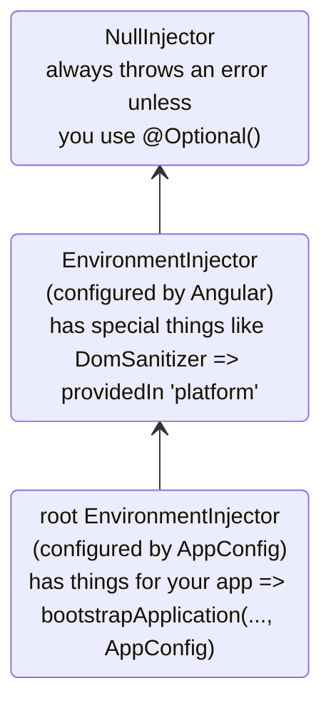
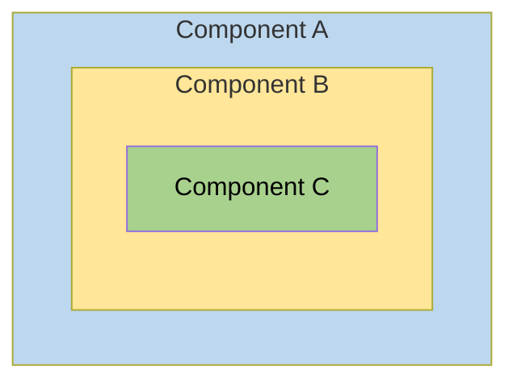
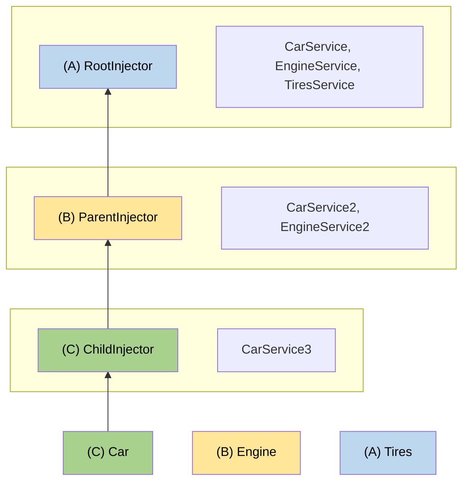

# Ierarxik injector'lar

Bu qoʻllanma Angular'ning ierarxik bogʻliqliklarni inyeksiya qilish tizimini, jumladan ruxsat (resolution) qoidalari, modifikatorlar va ilgʻor namunalarni chuqur yoritadi.

NOTE: Injector ierarxiyasi va provider qamrovi (scoping) haqidagi asosiy tushunchalar uchun [bogʻliqlik provider'larini aniqlash qoʻllanmasiga](guide/di/defining-dependency-providers#injector-hierarchy-in-angular) qarang.

## Injector ierarxiyalarining turlari {#types-of-injector-hierarchies}

Angular'da ikki injector ierarxiyasi mavjud:

| Injector ierarxiyalari           | Tafsilotlar                                                                                                                                                                   |
| :------------------------------ | :------------------------------------------------------------------------------------------------------------------------------------------------------------------------ |
| `EnvironmentInjector` ierarxiyasi | Bu ierarxiyadagi `EnvironmentInjector`'ni `@Service()` yoki `ApplicationConfig`'dagi `providers` massivi yordamida sozlang.                                                      |
| `ElementInjector` ierarxiyasi     | Har bir DOM elementida bilvosita yaratiladi. `ElementInjector` sukut boʻyicha boʻsh boʻladi, agar siz uni `@Directive()` yoki `@Component()`'ning `providers` xususiyatida sozlamasangiz. |

<docs-callout title="NgModule asosidagi ilovalar">
`NgModule` asosidagi ilovalar uchun bogʻliqliklarni `@NgModule()` yoki `@Injectable()` annotatsiyasi yordamida `ModuleInjector` ierarxiyasi orqali taqdim etishingiz mumkin.
</docs-callout>

### `EnvironmentInjector`

`EnvironmentInjector` ikki usuldan biri bilan sozlanishi mumkin:

- `@Service()` yordamida
- `ApplicationConfig`'ning `providers` massivi yordamida

<docs-callout title="Tree-shaking va @Service()">

`@Service()` dekoratoridan foydalanish `ApplicationConfig`'ning `providers` massividan foydalanishdan afzalroq. `@Service` bilan optimallashtirish vositalari tree-shaking bajara oladi, bu ilovangiz ishlatmaydigan servislarni olib tashlaydi. Natijada bundle hajmi kichikroq boʻladi.

Tree-shaking ayniqsa kutubxona uchun foydali, chunki kutubxonadan foydalanadigan ilovaga uni inyeksiya qilish kerak boʻlmasligi mumkin.

</docs-callout>

`EnvironmentInjector` `ApplicationConfig.providers` orqali sozlanadi.

Servislarni `@Service()` yordamida quyidagicha taqdim eting:

```ts {highlight:[4]}
import {Service} from '@angular/core';

@Service() // <--provides this service in the root EnvironmentInjector
export class ItemService {
  name = 'telephone';
}
```

`@Service()` yoki `@Injectable()` dekoratorlari servis klassini belgilaydi.

### ModuleInjector

`NgModule` asosidagi ilovalarda ModuleInjector ikki usuldan biri bilan sozlanishi mumkin:

- `@Service()` dekoratori yordamida,
- `root` yoki `platform`'ga ishora qiluvchi `@Injectable()`'ning `providedIn` xususiyati yordamida
- `@NgModule()`'ning `providers` massivi yordamida

`ModuleInjector` `@NgModule.providers` va `NgModule.imports` xususiyatlari orqali sozlanadi. `ModuleInjector` — `NgModule.imports`'ni rekursiv kuzatib borish orqali yetib borish mumkin boʻlgan barcha `providers` massivlarining yassilangan (flattened) toʻplami.

Bola `ModuleInjector` ierarxiyalari boshqa `@NgModules`'lar lazy loading orqali yuklanganda yaratiladi.

### Platforma injector'i {#platform-injector}

`root` ustida yana ikki injector mavjud: qoʻshimcha `EnvironmentInjector` va `NullInjector()`.

Angular ilovani `main.ts` faylidagi quyidagi kod bilan qanday ishga tushirishini (bootstrap) koʻrib chiqing:

```ts
bootstrapApplication(App, appConfig);
```

`bootstrapApplication()` metodi platforma injector'ining bola injector'ini yaratadi, u `ApplicationConfig` nusxasi orqali sozlanadi.
Bu `root` `EnvironmentInjector`'dir.

`bootstrapApplication()` metodi shuningdek platformaga xos bogʻliqliklarni oʻz ichiga olgan platforma injector'ini yaratadi (yoki qayta ishlatadi).
Bu bir nechta ilovaga platforma konfiguratsiyasini ulashish imkonini beradi.
Masalan, qancha ilova ishlab turganidan qatʼi nazar, brauzerda faqat bitta URL paneli bor.
`platformBrowser()` funksiyasiga `extraProviders` berish orqali platforma darajasida qoʻshimcha platformaga xos provider'larni sozlashingiz mumkin.

Ierarxiyadagi keyingi ota injector — `NullInjector()`, u daraxtning eng yuqori qismidir.
Agar siz daraxt boʻylab shunchalik yuqoriga chiqib, servisni `NullInjector()`'da izlayotgan boʻlsangiz, `@Optional()` ishlatmagan boʻlsangiz xato olasiz, chunki oxir-oqibat hamma narsa `NullInjector()`'da tugaydi va u xato qaytaradi yoki, `@Optional()` holatida, `null` qaytaradi.
`@Optional()` haqida koʻproq maʼlumot uchun ushbu qoʻllanmaning [`@Optional()` boʻlimiga](#optional) qarang.

Quyidagi diagramma oldingi paragraflarda tasvirlanganidek `root` `ModuleInjector` va uning ota injector'lari oʻrtasidagi munosabatni koʻrsatadi.



`root` nomi maxsus taxallus (alias) boʻlsa-da, boshqa `EnvironmentInjector` ierarxiyalarining taxalluslari yoʻq.
Dinamik yuklanadigan komponent yaratilganda, masalan Router bilan, `EnvironmentInjector` ierarxiyalarini yaratish imkoniyatingiz bor — Router bola `EnvironmentInjector` ierarxiyalarini yaratadi.

Barcha soʻrovlar root injector'ga yuqoriga uzatiladi — uni `bootstrapApplication()` metodiga uzatilgan `ApplicationConfig` nusxasi bilan sozlagan boʻlasizmi yoki barcha provider'larni oʻz servislarida `root` bilan roʻyxatdan oʻtkazgan boʻlasizmi, farqi yoʻq.

<docs-callout title="@Injectable() vs. ApplicationConfig">

Agar siz ilova boʻylab provider'ni `bootstrapApplication`'ning `ApplicationConfig`'ida sozlasangiz, u `@Injectable()` metamaʼlumotlarida `root` uchun sozlanganini bekor qiladi (override).
Bundan bir nechta ilova bilan ulashiladigan servisning standart boʻlmagan provider'ini sozlash uchun foydalanishingiz mumkin.

Quyida komponent router konfiguratsiyasi standart boʻlmagan [joylashuv strategiyasini](guide/routing/common-router-tasks#locationstrategy-and-browser-url-styles) oʻz ichiga olgan holatga misol keltirilgan — uning provider'i `ApplicationConfig`'ning `providers` roʻyxatida koʻrsatilgan.

```ts
providers: [{provide: LocationStrategy, useClass: HashLocationStrategy}];
```

`NgModule` asosidagi ilovalar uchun ilova boʻylab provider'larni `AppModule`'ning `providers`'ida sozlang.

</docs-callout>

### `ElementInjector`

Angular har bir DOM elementi uchun `ElementInjector` ierarxiyalarini bilvosita yaratadi.

Servisni `@Component()` dekoratorida uning `providers` yoki `viewProviders` xususiyati yordamida taqdim etish `ElementInjector`'ni sozlaydi.
Masalan, quyidagi `TestComponent` servisni quyidagicha taqdim etish orqali `ElementInjector`'ni sozlaydi:

```ts {highlight:[3]}
@Component({
  /* … */
  providers: [{ provide: ItemService, useValue: { name: 'lamp' } }]
})
export class TestComponent
```

HELPFUL: `EnvironmentInjector` daraxti, `ModuleInjector` va `ElementInjector` daraxti oʻrtasidagi munosabatni tushunish uchun [ruxsat qoidalari](#resolution-rules) boʻlimiga qarang.

Servislarni komponentda taqdim etganingizda, bu servis oʻsha komponent nusxasidagi `ElementInjector` orqali mavjud boʻladi.
U shuningdek [ruxsat qoidalari](#resolution-rules) boʻlimida tasvirlangan koʻrinish qoidalariga asosan bola komponent/direktivalarda ham koʻrinishi mumkin.

Komponent nusxasi yoʻq qilinganda, oʻsha servis nusxasi ham yoʻq qilinadi.

#### `@Directive()` va `@Component()` {#directive-and-component}

Komponent direktivaning maxsus turi, yaʼni `@Directive()`'da `providers` xususiyati boʻlgani kabi `@Component()`'da ham bor.
Bu direktivalar ham, komponentlar ham `providers` xususiyati yordamida provider'larni sozlashi mumkinligini anglatadi.
Komponent yoki direktiva uchun provider'ni `providers` xususiyati yordamida sozlaganingizda, bu provider oʻsha komponent yoki direktivaning `ElementInjector`'iga tegishli boʻladi.
Bir xil elementdagi komponentlar va direktivalar bir injector'ni ulashadi.

## Ruxsat qoidalari {#resolution-rules}

Komponent/direktiva uchun tokenni hal qilayotganda (resolve), Angular buni ikki bosqichda bajaradi:

1. `ElementInjector` ierarxiyasidagi ota injector'lar boʻylab.
2. `EnvironmentInjector` ierarxiyasidagi ota injector'lar boʻylab.

Komponent bogʻliqlikni eʼlon qilganda, Angular bu bogʻliqlikni oʻzining `ElementInjector`'i bilan qondirishga harakat qiladi.
Agar komponentning injector'ida provider boʻlmasa, u soʻrovni ota komponentining `ElementInjector`'iga yuqoriga uzatadi.

Soʻrovlar Angular soʻrovni bajara oladigan injector'ni topmaguncha yoki ajdod `ElementInjector` ierarxiyalari tugamaguncha yuqoriga uzatilishda davom etadi.

Agar Angular provider'ni hech qanday `ElementInjector` ierarxiyasida topmasa, u soʻrov kelib chiqqan elementga qaytadi va `EnvironmentInjector` ierarxiyasida izlaydi.
Agar Angular provider'ni hali ham topmasa, xato chiqaradi.

Agar siz bir xil DI token uchun provider'ni turli darajalarda roʻyxatdan oʻtkazgan boʻlsangiz, Angular birinchi duch kelganini bogʻliqlikni hal qilish uchun ishlatadi.
Masalan, agar provider servisga muhtoj komponentning oʻzida lokal roʻyxatdan oʻtkazilgan boʻlsa,
Angular bu servisning boshqa provider'ini izlamaydi.

HELPFUL: `NgModule` asosidagi ilovalar uchun Angular `ElementInjector` ierarxiyalarida provider'ni topa olmasa, `ModuleInjector` ierarxiyasini izlaydi.

## Ruxsat modifikatorlari {#resolution-modifiers}

Angular'ning ruxsat xatti-harakatini `optional`, `self`, `skipSelf` va `host` yordamida oʻzgartirish mumkin.
Ularning har birini `@angular/core`'dan import qiling va servisingizni inyeksiya qilayotganda har birini [`inject`](/api/core/inject) konfiguratsiyasida ishlating.

### Modifikatorlar turlari {#types-of-modifiers}

Ruxsat modifikatorlari uch toifaga boʻlinadi:

- Angular siz izlagan narsani topa olmasa nima qilish kerak, yaʼni `optional`
- Izlashni qayerdan boshlash, yaʼni `skipSelf`
- Izlashni qayerda toʻxtatish, `host` va `self`

Sukut boʻyicha Angular doimo joriy `Injector`'dan boshlaydi va eng yuqorigacha izlashda davom etadi.
Modifikatorlar boshlangʻich, yaʼni _self_, joylashuvni va yakuniy joylashuvni oʻzgartirish imkonini beradi.

Bundan tashqari, quyidagilardan boshqa barcha modifikatorlarni birlashtirishingiz mumkin:

- `host` va `self`
- `skipSelf` va `self`.

### `optional`

`optional` Angular'ga siz inyeksiya qilayotgan servisni ixtiyoriy deb hisoblash imkonini beradi.
Shu tarzda, agar u ishga tushirish vaqtida (runtime) hal qilina olmasa, Angular xato chiqarish oʻrniga servisni `null` sifatida hal qiladi.
Quyidagi misolda `OptionalService` servisi servisda, `ApplicationConfig`'da, `@NgModule()`'da yoki komponent klassida taqdim etilmagan, shuning uchun u ilovaning hech qayerida mavjud emas.

```ts {header:"src/app/optional/optional.ts"}
export class Optional {
  public optional? = inject(OptionalService, {optional: true});
}
```

### `self`

Angular faqat joriy komponent yoki direktivaning `ElementInjector`'ida izlashi uchun `self`'dan foydalaning.

`self` uchun yaxshi foydalanish holati — servisni faqat joriy host elementda mavjud boʻlsa inyeksiya qilish.
Bu holatda xatolardan qochish uchun `self`'ni `optional` bilan birlashtiring.

Masalan, quyidagi `SelfNoData`'da xususiyat sifatida inyeksiya qilingan `LeafService`'ga eʼtibor bering.

```ts {header: 'self-no-data.ts', highlight: [7]}
@Component({
  selector: 'app-self-no-data',
  templateUrl: './self-no-data.html',
  styleUrls: ['./self-no-data.css'],
})
export class SelfNoData {
  public leaf = inject(LeafService, {optional: true, self: true});
}
```

Bu misolda ota provider mavjud va servisni inyeksiya qilish qiymatni qaytaradi, biroq servisni `self` va `optional` bilan inyeksiya qilish `null` qaytaradi, chunki `self` injector'ga izlashni joriy host elementda toʻxtatishni buyuradi.

Boshqa misol `FlowerService` uchun provider'ga ega komponent klassini koʻrsatadi.
Bu holatda injector joriy `ElementInjector`'dan nariga qaramaydi, chunki u `FlowerService`'ni topadi va lolani 🌷 qaytaradi.

```ts {header:"src/app/self/self.ts"}
@Component({
  selector: 'app-self',
  templateUrl: './self.html',
  styleUrls: ['./self.css'],
  providers: [{provide: FlowerService, useValue: {emoji: '🌷'}}],
})
export class Self {
  public flower = inject(FlowerService, {self: true});
}
```

### `skipSelf`

`skipSelf` — `self`'ning aksi.
`skipSelf` bilan Angular servisni izlashni joriy `ElementInjector`'dan emas, ota `ElementInjector`'dan boshlaydi.
Shunday qilib, agar ota `ElementInjector` `emoji` uchun paporotnik <code>🌿</code> qiymatini ishlatayotgan boʻlsa, siz esa komponentning `providers` massivida chinor bargi <code>🍁</code> qiymatiga ega boʻlsangiz, Angular chinor bargini <code>🍁</code> eʼtiborsiz qoldirib, paporotnikni <code>🌿</code> ishlatadi.

Buni kodda koʻrish uchun, ota komponent `emoji` uchun quyidagi qiymatni ishlatayotgan deb faraz qiling, ushbu servisdagi kabi:

```ts {header: 'leaf.service.ts'}
export class LeafService {
  emoji = '🌿';
}
```

Tasavvur qiling, bola komponentda sizda boshqa qiymat, chinor bargi 🍁 bor, lekin siz oʻrniga otaning qiymatini ishlatmoqchisiz.
`skipSelf`'ni aynan shunda ishlatasiz:

```ts {header:"skipself.ts" highlight:[[6],[10]]}
@Component({
  selector: 'app-skipself',
  templateUrl: './skipself.html',
  styleUrls: ['./skipself.css'],
  // Angular would ignore this LeafService instance
  providers: [{provide: LeafService, useValue: {emoji: '🍁'}}],
})
export class Skipself {
  // Use skipSelf as inject option
  public leaf = inject(LeafService, {skipSelf: true});
}
```

Bu holatda `emoji` uchun olinadigan qiymat chinor bargi <code>🍁</code> emas, paporotnik <code>🌿</code> boʻladi.

#### `skipSelf` opsiyasi `optional` bilan {#skipself-option-with-optional}

Qiymat `null` boʻlganda xatoning oldini olish uchun `skipSelf` opsiyasini `optional` bilan ishlating.

Quyidagi misolda `Person` servisi xususiyatni initsializatsiya qilish vaqtida inyeksiya qilinadi.
`skipSelf` Angular'ga joriy injector'ni oʻtkazib yuborishni buyuradi, `optional` esa `Person` servisi `null` boʻlsa xatoning oldini oladi.

```ts
class Person {
  parent = inject(Person, {optional: true, skipSelf: true});
}
```

### `host`

<!-- TODO: Remove ambiguity between host and self. -->

`host` provider'larni izlashda komponentni injector daraxtidagi soʻnggi toʻxtash nuqtasi sifatida belgilash imkonini beradi.

Daraxtda yuqoriroqda servis nusxasi boʻlsa ham, Angular izlashni davom ettirmaydi.
`host`'dan quyidagicha foydalaning:

```ts {header:"host.ts" highlight:[[6],[9]]}
@Component({
  selector: 'app-host',
  templateUrl: './host.html',
  styleUrls: ['./host.css'],
  // provide the service
  providers: [{provide: FlowerService, useValue: {emoji: '🌷'}}],
})
export class Host {
  // use host when injecting the service
  flower = inject(FlowerService, {host: true, optional: true});
}
```

`Host`'da `host` opsiyasi boʻlgani uchun, `Host`'ning otasida `flower.emoji` qiymati sifatida nima boʻlishidan qatʼi nazar, `Host` lolani <code>🌷</code> ishlatadi.

### Konstruktor inyeksiyasi bilan modifikatorlar {#modifiers-with-constructor-injection}

Yuqorida koʻrsatilganiga oʻxshab, konstruktor inyeksiyasining xatti-harakatini `@Optional()`, `@Self()`, `@SkipSelf()` va `@Host()` yordamida oʻzgartirish mumkin.

Ularning har birini `@angular/core`'dan import qiling va servisingizni inyeksiya qilayotganda har birini komponent klassining konstruktorida ishlating.

```ts {header:"self-no-data.ts" highlight:[2]}
export class SelfNoData {
  constructor(@Self() @Optional() public leaf?: LeafService) {}
}
```

## Shablonning mantiqiy tuzilmasi {#logical-structure-of-the-template}

Servislarni komponent klassida taqdim etganingizda, servislar `ElementInjector` daraxti ichida ularni qayerda va qanday taqdim etganingizga nisbatan koʻrinadi.

Angular shablonining asosiy mantiqiy tuzilmasini tushunish sizga servislarni sozlash va oʻz navbatida ularning koʻrinishini boshqarish uchun asos beradi.

Komponentlar shablonlaringizda quyidagi misoldagi kabi ishlatiladi:

```html
<app-root> <app-child />; </app-root>
```

HELPFUL: Odatda siz komponentlar va ularning shablonlarini alohida fayllarda eʼlon qilasiz.
Inyeksiya tizimi qanday ishlashini tushunish uchun ularga birlashtirilgan mantiqiy daraxt nuqtai nazaridan qarash foydali.
_Mantiqiy_ atamasi uni render daraxtidan, yaʼni ilovangizning DOM daraxtidan farqlaydi.
Komponent shablonlari joylashgan oʻrinlarni belgilash uchun bu qoʻllanma `<#VIEW>` psevdo-elementini ishlatadi — u render daraxtida aslida mavjud emas va faqat tasavvur modeli uchun keltirilgan.

Quyida `<app-root>` va `<app-child>` view daraxtlarining yagona mantiqiy daraxtga qanday birlashtirilishiga misol keltirilgan:

```html
<app-root>
  <#VIEW>
    <app-child>
     <#VIEW>
       …content goes here…
     </#VIEW>
    </app-child>
  </#VIEW>
</app-root>
```

`<#VIEW>` chegarasi gʻoyasini tushunish servislarni komponent klassida sozlaganingizda ayniqsa muhim.

## Misol: `@Component()`'da servislarni taqdim etish {#example-providing-services-in-component}

Servislarni `@Component()` (yoki `@Directive()`) dekoratori yordamida qanday taqdim etishingiz ularning koʻrinishini belgilaydi.
Quyidagi boʻlimlar `providers` va `viewProviders`'ni, shuningdek servis koʻrinishini `skipSelf` va `host` yordamida oʻzgartirish usullarini koʻrsatadi.

Komponent klassi servislarni ikki usulda taqdim etishi mumkin:

| Massivlar                     | Tafsilotlar                                    |
| :--------------------------- | :--------------------------------------------- |
| `providers` massivi bilan     | `@Component({ providers: [SomeService] })`     |
| `viewProviders` massivi bilan | `@Component({ viewProviders: [SomeService] })` |

Quyidagi misollarda siz Angular ilovasining mantiqiy daraxtini koʻrasiz.
Injector shablonlar kontekstida qanday ishlashini koʻrsatish uchun mantiqiy daraxt ilovaning HTML tuzilmasini ifodalaydi.
Masalan, mantiqiy daraxt `<child-component>`'ning `<parent-component>`'ning bevosita bolasi ekanini koʻrsatadi.

Mantiqiy daraxtda siz maxsus atributlarni koʻrasiz: `@Provide`, `@Inject` va `@ApplicationConfig`.
Bular haqiqiy atributlar emas, ular ichkarida nima sodir boʻlayotganini koʻrsatish uchun keltirilgan.

| Angular servis atributi    | Tafsilotlar                                                                                  |
| :------------------------ | :--------------------------------------------------------------------------------------- |
| `@Inject(Token)=>Value`   | Agar `Token` mantiqiy daraxtning shu joyida inyeksiya qilinsa, uning qiymati `Value` boʻladi. |
| `@Provide(Token=Value)`   | `Token` mantiqiy daraxtning shu joyida `Value` bilan taqdim etilganini bildiradi.    |
| `@ApplicationConfig`      | Shu joyda zaxira (fallback) `EnvironmentInjector` ishlatilishi kerakligini koʻrsatadi.      |

### Misol ilova tuzilmasi {#example-app-structure}

Misol ilovada `root`'da taqdim etilgan, `emoji` qiymati qizil gibiskus <code>🌺</code> boʻlgan `FlowerService` mavjud.

```ts {header:"flower.service.ts"}
@Service()
export class FlowerService {
  emoji = '🌺';
}
```

Faqat `App` va `Child`'dan iborat ilovani koʻrib chiqing.
Eng oddiy render qilingan view quyidagi kabi ichma-ich HTML elementlariga oʻxshaydi:

```html
<app-root>
  <!-- App selector -->
  <app-child> <!-- Child selector --> </app-child>
</app-root>
```

Biroq, sahna ortida Angular inyeksiya soʻrovlarini hal qilayotganda quyidagi kabi mantiqiy view tasviridan foydalanadi:

```html
<app-root> <!-- App selector -->
  <#VIEW>
    <app-child> <!-- Child selector -->
      <#VIEW>
      </#VIEW>
    </app-child>
  </#VIEW>
</app-root>
```

Bu yerdagi `<#VIEW>` shablon nusxasini ifodalaydi.
Har bir komponentning oʻz `<#VIEW>`'i borligiga eʼtibor bering.

Bu tuzilmani bilish servislaringizni qanday taqdim etishingiz va inyeksiya qilishingizga yoʻl koʻrsatishi va servis koʻrinishi ustidan toʻliq nazorat berishi mumkin.

Endi `<app-root>` `FlowerService`'ni inyeksiya qiladi deb hisoblang:

```typescript
export class App {
  flower = inject(FlowerService);
}
```

Natijani koʻrish uchun `<app-root>` shabloniga bogʻlash qoʻshing:

```html
<p>Emoji from FlowerService: {{flower.emoji}}</p>
```

View'dagi chiqish quyidagicha boʻladi:

```text {hideCopy}
Emoji from FlowerService: 🌺
```

Mantiqiy daraxtda bu quyidagicha ifodalanadi:

```html
<app-root @ApplicationConfig
        @Inject(FlowerService) flower=>"🌺">
  <#VIEW>
    <p>Emoji from FlowerService: {{flower.emoji}} (🌺)</p>
    <app-child>
      <#VIEW>
      </#VIEW>
    </app-child>
  </#VIEW>
</app-root>
```

`<app-root>` `FlowerService`'ni soʻraganda, `FlowerService` tokenini hal qilish injector'ning vazifasi.
Tokenni hal qilish ikki bosqichda sodir boʻladi:

1. Injector mantiqiy daraxtda izlashning boshlangʻich joylashuvini va yakuniy joylashuvini aniqlaydi.
   Injector boshlangʻich joylashuvdan boshlaydi va mantiqiy daraxtning har bir view darajasida tokenni izlaydi.
   Agar token topilsa, u qaytariladi.

1. Agar token topilmasa, injector soʻrovni topshirish uchun eng yaqin ota `EnvironmentInjector`'ni izlaydi.

Misol holatida cheklovlar quyidagicha:

1. `<app-root>`'ga tegishli `<#VIEW>`'dan boshlab `<app-root>`'da tugatish.
   - Odatda izlashning boshlangʻich nuqtasi inyeksiya nuqtasida boʻladi.
     Biroq, bu holatda `<app-root>` — komponent. `@Component`'lar maxsus, chunki ular oʻzlarining `viewProviders`'ini ham oʻz ichiga oladi, shuning uchun izlash `<app-root>`'ga tegishli `<#VIEW>`'dan boshlanadi.
     Xuddi shu joyda moslashgan direktiva uchun bunday boʻlmas edi.
   - Yakuniy joylashuv komponentning oʻzi bilan bir xil boʻlib chiqadi, chunki u bu ilovadagi eng yuqori komponent.

1. `ApplicationConfig` tomonidan taqdim etilgan `EnvironmentInjector` inyeksiya tokeni `ElementInjector` ierarxiyalarida topilmaganda zaxira (fallback) injector vazifasini bajaradi.

### `providers` massividan foydalanish {#using-the-providers-array}

Endi, keyingi boʻlimlarda murakkabroq ruxsat qoidalarini koʻrsatish uchun `Child` klassiga `FlowerService` uchun provider qoʻshing:

```ts
@Component({
  selector: 'app-child',
  templateUrl: './child.html',
  styleUrls: ['./child.css'],
  // use the providers array to provide a service
  providers: [{provide: FlowerService, useValue: {emoji: '🌻'}}],
})
export class Child {
  // inject the service
  flower = inject(FlowerService);
}
```

Endi `FlowerService` `@Component()` dekoratorida taqdim etilgani uchun, `<app-child>` servisni soʻraganda injector faqat `<app-child>`'dagi `ElementInjector`'gacha qarashi kifoya.
Unga injector daraxti boʻylab izlashni davom ettirish kerak boʻlmaydi.

Keyingi qadam — `Child` shabloniga bogʻlash qoʻshish.

```html
<p>Emoji from FlowerService: {{flower.emoji}}</p>
```

Yangi qiymatlarni render qilish uchun `<app-child>`'ni `App` shablonining pastki qismiga qoʻshing, shunda view kungaboqarni ham koʻrsatadi:

```text {hideCopy}
Child Component
Emoji from FlowerService: 🌻
```

Mantiqiy daraxtda bu quyidagicha ifodalanadi:

```html
<app-root @ApplicationConfig
          @Inject(FlowerService) flower=>"🌺">
  <#VIEW>

  <p>Emoji from FlowerService: {{flower.emoji}} (🌺)</p>
  <app-child @Provide(FlowerService="🌻" )
             @Inject(FlowerService)=>"🌻"> <!-- search ends here -->
    <#VIEW> <!-- search starts here -->
    <h2>Child Component</h2>
    <p>Emoji from FlowerService: {{flower.emoji}} (🌻)</p>
  </
  #VIEW>
  </app-child>
</#VIEW>
</app-root>
```

`<app-child>` `FlowerService`'ni soʻraganda, injector izlashni `<app-child>`'ga tegishli `<#VIEW>`'dan boshlaydi \(`<#VIEW>` kiritilgan, chunki u `@Component()`'dan inyeksiya qilinadi\) va `<app-child>`'da tugatadi.
Bu holatda `FlowerService` `<app-child>`'ning `providers` massivida kungaboqar <code>🌻</code> bilan hal qilinadi.
Injector'ga injector daraxtida boshqa izlash kerak boʻlmaydi.
U `FlowerService`'ni topishi bilan toʻxtaydi va qizil gibiskusni <code>🌺</code> hech qachon koʻrmaydi.

### `viewProviders` massividan foydalanish {#using-the-viewproviders-array}

`@Component()` dekoratorida servislarni taqdim etishning boshqa usuli sifatida `viewProviders` massividan foydalaning.
`viewProviders`'dan foydalanish servislarni `<#VIEW>`'da koʻrinadigan qiladi.

HELPFUL: Qadamlar `providers` massividan foydalanish bilan bir xil, faqat oʻrniga `viewProviders` massivi ishlatiladi.

Bosqichma-bosqich koʻrsatmalar uchun ushbu boʻlim bilan davom eting.
Agar buni oʻzingiz sozlay olsangiz, [Servis mavjudligini oʻzgartirish](#visibility-of-provided-tokens) boʻlimiga oʻting.

Namoyish uchun biz `viewProviders`'ni koʻrsatish maqsadida `AnimalService` yaratamiz.
Avval `emoji` xususiyati kit <code>🐳</code> boʻlgan `AnimalService` yarating:

```typescript
import {Service} from '@angular/core';

@Service()
export class AnimalService {
  emoji = '🐳';
}
```

`FlowerService` bilan boʻlgani kabi bir xil namunaga amal qilib, `AnimalService`'ni `App` klassiga inyeksiya qiling:

```ts
export class App {
  public flower = inject(FlowerService);
  public animal = inject(AnimalService);
}
```

HELPFUL: `FlowerService`'ga tegishli barcha kodni joyida qoldirishingiz mumkin, chunki bu `AnimalService` bilan solishtirish imkonini beradi.

`<app-child>` klassiga ham `viewProviders` massivini qoʻshing va `AnimalService`'ni inyeksiya qiling, lekin `emoji`'ga boshqa qiymat bering.
Bu yerda uning qiymati kuchuk 🐶.

```typescript
@Component({
  selector: 'app-child',
  templateUrl: './child.html',
  styleUrls: ['./child.css'],
  // provide services
  providers: [{provide: FlowerService, useValue: {emoji: '🌻'}}],
  viewProviders: [{provide: AnimalService, useValue: {emoji: '🐶'}}],
})
export class Child {
  // inject services
  flower = inject(FlowerService);
  animal = inject(AnimalService);
}
```

`Child` va `App` shablonlariga bogʻlashlar qoʻshing.
`Child` shabloniga quyidagi bogʻlashni qoʻshing:

```html
<p>Emoji from AnimalService: {{animal.emoji}}</p>
```

Bundan tashqari, xuddi shuni `App` shabloniga ham qoʻshing:

```html
<p>Emoji from AnimalService: {{animal.emoji}}</p>
```

Endi brauzerda ikkala qiymatni koʻrishingiz kerak:

```text {hideCopy}
App
Emoji from AnimalService: 🐳

Child Component
Emoji from AnimalService: 🐶
```

Ushbu `viewProviders` misoli uchun mantiqiy daraxt quyidagicha:

```html
<app-root @ApplicationConfig
          @Inject(AnimalService) animal=>"🐳">
  <#VIEW>
  <app-child>
    <#VIEW @Provide(AnimalService="🐶")
    @Inject(AnimalService=>"🐶")>

    <!-- ^^using viewProviders means AnimalService is available in <#VIEW>-->
    <p>Emoji from AnimalService: {{animal.emoji}} (🐶)</p>
  </
  #VIEW>
  </app-child>
</#VIEW>
</app-root>
```

`FlowerService` misolidagi kabi, `AnimalService` `<app-child>`'ning `@Component()` dekoratorida taqdim etilgan.
Bu shuni anglatadiki, injector avval komponentning `ElementInjector`'ida izlagani uchun u `AnimalService`'ning kuchuk <code>🐶</code> qiymatini topadi.
Unga `ElementInjector` daraxtida izlashni davom ettirish ham, `ModuleInjector`'da izlash ham kerak emas.

### `providers` vs. `viewProviders` {#providers-vs-viewproviders}

`viewProviders` maydoni konseptual jihatdan `providers`'ga oʻxshaydi, lekin bitta muhim farq bor.
`viewProviders`'dagi provider'lar faqat komponentning oʻz view'i ichida koʻrinadi — komponentga `<ng-content>` orqali proyeksiya qilingan kontent ularni koʻra olmaydi.

`providers` va `viewProviders`'dan foydalanish oʻrtasidagi farqni koʻrish uchun misolga boshqa komponent qoʻshing va uni `Inspector` deb nomlang.
`Inspector` `Child`'ning bolasi boʻladi.
`inspector.ts`'da xususiyatni initsializatsiya qilish vaqtida `FlowerService` va `AnimalService`'ni inyeksiya qiling:

```typescript
export class Inspector {
  flower = inject(FlowerService);
  animal = inject(AnimalService);
}
```

Sizga `providers` yoki `viewProviders` massivi kerak emas.
Keyin, `inspector.html`'ga oldingi komponentlardagi bir xil markup'ni qoʻshing:

```html
<p>Emoji from FlowerService: {{flower.emoji}}</p>
<p>Emoji from AnimalService: {{animal.emoji}}</p>
```

`Inspector`'ni `Child`'ning `imports` massiviga qoʻshishni unutmang.

```ts
@Component({
  ...
  imports: [Inspector]
})
```

Keyin, `child.html`'ga quyidagini qoʻshing:

```html
...

<div class="container">
  <h3>Content projection</h3>
  <ng-content />
</div>
<h3>Inside the view</h3>

<app-inspector />
```

`<ng-content>` kontentni proyeksiya qilish imkonini beradi, `Child` shablonidagi `<app-inspector>` esa `Inspector`'ni `Child`'ning bola komponentiga aylantiradi.

Keyin, kontent proyeksiyasidan foydalanish uchun `app.html`'ga quyidagini qoʻshing.

```html
<app-child>
  <app-inspector />
</app-child>
```

Brauzer endi quyidagini render qiladi (qisqalik uchun oldingi misollar tushirib qoldirilgan):

```text {hideCopy}
...
Content projection

Emoji from FlowerService: 🌻
Emoji from AnimalService: 🐳

Emoji from FlowerService: 🌻
Emoji from AnimalService: 🐶
```

Bu toʻrt bogʻlash `providers` va `viewProviders` oʻrtasidagi farqni koʻrsatadi.
Esda tuting, kuchuk emojisi <code>🐶</code> `Child`'ning `<#VIEW>`'i ichida eʼlon qilingan va proyeksiya qilingan kontentga koʻrinmaydi.
Buning oʻrniga proyeksiya qilingan kontent kitni <code>🐳</code> koʻradi.

Proyeksiya qilingan `<app-inspector>` nega hali ham root'da taqdim etilgan `AnimalService` boʻlgan <code>🐳</code>'ni koʻra olishiga hayron boʻlishingiz mumkin.
Sababi shundaki, Angular DI komponent **qayerda eʼlon qilinganini** kuzatadi, qayerda render qilinishini emas.
`<app-inspector>` `App`'ning shablonida, `App`'ning `<#VIEW>`'i ichida yashaydi, shuning uchun uning izlashi hech qachon `Child`'ning `<#VIEW>`'i orqali oʻtmaydi.
Uni `Child`'ga proyeksiya qilish `Child`'ning `viewProviders`'iga (<code>🐶</code>) kirishni kesib qoʻyadi, lekin root `AnimalService` (<code>🐳</code>) daraxt boʻylab yuqorida hali ham yetib boriladigan boʻlib qoladi.

Biroq, keyingi chiqish boʻlimida `Inspector` `Child`'ning haqiqiy bola komponenti, `Inspector` `<#VIEW>` ichida, shuning uchun u `AnimalService`'ni soʻraganda kuchukni <code>🐶</code> koʻradi.

Mantiqiy daraxtdagi `AnimalService` quyidagicha koʻrinadi:

```html
<app-root @ApplicationConfig
          @Inject(AnimalService) animal=>"🐳">
  <#VIEW>
  <app-child>
    <#VIEW @Provide(AnimalService="🐶")
    @Inject(AnimalService=>"🐶")>

    <!-- ^^using viewProviders means AnimalService is available in <#VIEW>-->
    <p>Emoji from AnimalService: {{animal.emoji}} (🐶)</p>

    <div class="container">
      <h3>Content projection</h3>
      <app-inspector @Inject(AnimalService) animal=>"🐳">
        <p>Emoji from AnimalService: {{animal.emoji}} (🐳)</p>
      </app-inspector>
    </div>

    <app-inspector>
      <#VIEW @Inject(AnimalService) animal=>"🐶">
      <p>Emoji from AnimalService: {{animal.emoji}} (🐶)</p>
    </
    #VIEW>
    </app-inspector>
  </
  #VIEW>
  </app-child>

</#VIEW>
</app-root>
```

Proyeksiya qilingan `<app-inspector>` <code>🐳</code>'ni oladi, chunki <code>🐶</code> `Child`'ning view'iga tegishli va proyeksiya qilingan kontent unga yeta olmaydi.
<code>🐳</code> esa mavjud, chunki `<app-inspector>` `App`'ning shablonida eʼlon qilingan, shuning uchun u hali ham root `AnimalService`'gacha yuqoriga koʻtarila oladi.

Bevosita `Child`'ning shabloni ichida yashaydigan (proyeksiya qilinmagan) `<app-inspector>` <code>🐶</code>'ni oladi — u `<#VIEW>` ichida, shuning uchun kesib oʻtish kerak boʻlgan chegara yoʻq.

### Proyeksiya qilingan kontentga view injector'iga kirish imkonini berish {#giving-projected-content-access-to-a-view-injector}

`<ng-content>` bilan proyeksiya qilingan kontent komponentning `viewProviders`'ini koʻra olmaydi, chunki Angular inyeksiyani kontent render qilinadigan joy emas, eʼlon qilingan joydagi injector boʻyicha hal qiladi.

Agar siz proyeksiya qilingan kontentning view darajasidagi servisga — yoki proyeksiya qiluvchi komponent nusxasining oʻziga — yetib borishini aniq istasangiz, kontentni `<ng-content>` oʻrniga shablon sifatida qabul qiling va uni aniq injector bilan render qiling.

`Child`'ni `AnimalService`'ni `viewProviders`'da taqdim etadigan, proyeksiya qilingan shablonni soʻraydigan (query) va uni [`NgTemplateOutlet`](/api/common/NgTemplateOutlet) orqali `ngTemplateOutletInjector`'ni oʻsha servisni koʻra oladigan injector'ga oʻrnatib render qiladigan tarzda yangilang:

```ts
@Component({
  selector: 'app-child',
  viewProviders: [AnimalService],
  imports: [NgTemplateOutlet],
  template: `
    <ng-container [ngTemplateOutlet]="content()" [ngTemplateOutletInjector]="injector" />
  `,
})
export class Child {
  readonly content = contentChild.required(TemplateRef);
  readonly injector = inject(Injector);
}
```

Isteʼmolchi proyeksiya qilinadigan markup'ni `<ng-template>`'ga oʻraydi:

```html
<app-child>
  <ng-template>
    <app-inspector />
  </ng-template>
</app-child>
```

`Child` endi `<app-inspector>`'ni outlet'da oʻz injector'i yordamida yaratadi, shuning uchun markup `App`'ning shablonida yozilgan boʻlsa ham `AnimalService` kuchukga <code>🐶</code> hal qilinadi. Buning narxi — `<ng-content>` bilan solishtirganda ikkala tomonda ozgina qoʻshimcha markup.

### Taqdim etilgan tokenlarning koʻrinishi {#visibility-of-provided-tokens}

Koʻrinish dekoratorlari mantiqiy daraxtda inyeksiya tokenini izlash qayerdan boshlanishi va qayerda tugashiga taʼsir qiladi.
Buning uchun koʻrinish konfiguratsiyasini eʼlon qilish nuqtasida emas, inyeksiya nuqtasida, yaʼni `inject()` chaqirilayotganda joylashtiring.

Injector `FlowerService`'ni qayerdan izlashni boshlashini oʻzgartirish uchun `<app-child>`'da `FlowerService` inyeksiya qilinadigan `inject()` chaqiruviga `skipSelf` qoʻshing.
Bu chaqiruv `child.ts`'da koʻrsatilganidek `<app-child>`'dagi xususiyat initsializatori:

```typescript
flower = inject(FlowerService, {skipSelf: true});
```

`skipSelf` bilan `<app-child>` injector'i `FlowerService`'ni oʻzida izlamaydi.
Buning oʻrniga injector `FlowerService`'ni izlashni `<app-root>`'ning `ElementInjector`'idan boshlaydi va u yerda hech narsa topmaydi.
Keyin u `<app-child>`'ning `ModuleInjector`'iga qaytadi va qizil gibiskus <code>🌺</code> qiymatini topadi — bu qiymat mavjud, chunki `<app-child>` va `<app-root>` bir xil `ModuleInjector`'ni ulashadi.
UI quyidagini render qiladi:

```text {hideCopy}
Emoji from FlowerService: 🌺
```

Mantiqiy daraxtda xuddi shu gʻoya quyidagicha koʻrinishi mumkin:

```html
<app-root @ApplicationConfig
          @Inject(FlowerService) flower=>"🌺">
  <#VIEW>
  <app-child @Provide(FlowerService="🌻" )>
    <#VIEW @Inject(FlowerService, SkipSelf)=>"🌺">

    <!-- With SkipSelf, the injector looks to the next injector up the tree (app-root) -->

  </
  #VIEW>
  </app-child>
</#VIEW>
</app-root>
```

`<app-child>` kungaboqarni <code>🌻</code> taqdim etsa-da, ilova qizil gibiskusni <code>🌺</code> render qiladi, chunki `skipSelf` joriy injector'ni (`app-child`) oʻzini oʻtkazib yuborib, otasiga qarashga majbur qiladi.

Agar endi (`skipSelf`'ga qoʻshimcha ravishda) `host` qoʻshsangiz, natija `null` boʻladi.
Buning sababi `host` izlashning yuqori chegarasini `app-child`'ning `<#VIEW>`'i bilan cheklaydi.
Mantiqiy daraxtdagi gʻoya quyidagicha:

```html
<app-root @ApplicationConfig
          @Inject(FlowerService) flower=>"🌺">
  <#VIEW> <!-- end search here with null-->
  <app-child @Provide(FlowerService="🌻" )> <!-- start search here -->
    <#VIEW inject(FlowerService, {skipSelf: true, host: true, optional:true})=>null>
  </
  #VIEW>
  </app-parent>
</#VIEW>
</app-root>
```

Bu yerda servislar va ularning qiymatlari bir xil, lekin `host` injector'ning `FlowerService`'ni `<#VIEW>`'dan nariga izlashini toʻxtatadi, shuning uchun u topilmaydi va `null` qaytariladi.

### `skipSelf` va `viewProviders` {#skipself-and-viewproviders}

Esda tuting, `<app-child>` `AnimalService`'ni `viewProviders` massivida kuchuk <code>🐶</code> qiymati bilan taqdim etadi.
Injector `AnimalService` uchun faqat `<app-child>`'ning `ElementInjector`'iga qarashi kifoya boʻlgani uchun, u kitni <code>🐳</code> hech qachon koʻrmaydi.

`FlowerService` misolidagi kabi, agar `AnimalService`'ning `inject()`'iga `skipSelf` qoʻshsangiz, injector `AnimalService`'ni joriy `<app-child>`'ning `ElementInjector`'ida izlamaydi.
Buning oʻrniga injector `<app-root>`'ning `ElementInjector`'idan boshlaydi.

```typescript
@Component({
  selector: 'app-child',
  …
  viewProviders: [
    { provide: AnimalService, useValue: { emoji: '🐶' } },
  ],
})
```

`<app-child>`'da `skipSelf` bilan mantiqiy daraxt quyidagicha koʻrinadi:

```html
<app-root @ApplicationConfig
          @Inject(AnimalService=>"🐳")>
  <#VIEW><!-- search begins here -->
  <app-child>
    <#VIEW @Provide(AnimalService="🐶")
    @Inject(AnimalService, SkipSelf=>"🐳")>

    <!--Add skipSelf -->

  </
  #VIEW>
  </app-child>
</#VIEW>
</app-root>
```

`<app-child>`'da `skipSelf` bilan injector `AnimalService`'ni izlashni `<app-root>`'ning `ElementInjector`'idan boshlaydi va kitni 🐳 topadi.

### `host` va `viewProviders` {#host-and-viewproviders}

Agar `AnimalService` inyeksiyasi uchun faqat `host`'dan foydalansangiz, natija kuchuk <code>🐶</code> boʻladi, chunki injector `AnimalService`'ni `<app-child>`'ning `<#VIEW>`'ida topadi.
`Child` `viewProviders`'ni kuchuk emojisi `AnimalService` qiymati sifatida taqdim etiladigan tarzda sozlaydi.
`host`'ni `inject()`'da ham koʻrishingiz mumkin:

```typescript
@Component({
  selector: 'app-child',
  …
  viewProviders: [
    { provide: AnimalService, useValue: { emoji: '🐶' } },
  ]
})
export class Child {
  animal = inject(AnimalService, { host: true })
}
```

`host: true` injector'ni `<#VIEW>` chegarasiga duch kelguncha izlashga majbur qiladi.

```html
<app-root @ApplicationConfig
          @Inject(AnimalService=>"🐳")>
  <#VIEW>
  <app-child>
    <#VIEW @Provide(AnimalService="🐶")
    inject(AnimalService, {host: true}=>"🐶")> <!-- host stops search here -->
  </
  #VIEW>
  </app-child>
</#VIEW>
</app-root>
```

`app.ts`'dagi `@Component()` metamaʼlumotlariga uchinchi hayvon, tipratikan <code>🦔</code> bilan `viewProviders` massivini qoʻshing:

```typescript
@Component({
  selector: 'app-root',
  templateUrl: './app.html',
  styleUrls: [ './app.css' ],
  viewProviders: [
    { provide: AnimalService, useValue: { emoji: '🦔' } },
  ],
})
```

Keyin, `child.ts`'da `AnimalService` inyeksiyasi uchun `inject()`'ga `host` bilan birga `skipSelf` qoʻshing.
Quyida `animal` xususiyati initsializatsiyasida `host` va `skipSelf` keltirilgan:

```typescript
export class Child {
  animal = inject(AnimalService, {host: true, skipSelf: true});
}
```

<!-- TODO: This requires a rework. It seems not well explained what `viewProviders`/`injectors` is here
  and how `host` works.
 -->

`host` va `skipSelf` `providers` massividagi `FlowerService`'ga qoʻllanganda natija `null` boʻlgan edi, chunki `skipSelf` izlashni `<app-child>` injector'ida boshlaydi, `host` esa izlashni `<#VIEW>`'da toʻxtatadi — u yerda `FlowerService` yoʻq
Mantiqiy daraxtda `FlowerService`'ning `<app-child>`'da koʻrinishini, uning `<#VIEW>`'ida emasligini koʻrishingiz mumkin.

Biroq, `App`'ning `viewProviders` massivida taqdim etilgan `AnimalService` koʻrinadi.

Mantiqiy daraxt tasviri bunga sababni koʻrsatadi:

```html
<app-root @ApplicationConfig
          @Inject(AnimalService=>"🐳")>
  <#VIEW @Provide(AnimalService="🦔")
  @Inject(AnimalService, @Optional)=>"🦔">

  <!-- ^^skipSelf starts here,  host stops here^^ -->
  <app-child>
    <#VIEW @Provide(AnimalService="🐶")
    inject(AnimalService, {skipSelf:true, host: true, optional: true})=>"🦔">
    <!-- Add skipSelf ^^-->
  </
  #VIEW>
  </app-child>
</#VIEW>
</app-root>
```

`skipSelf` injector'ni `AnimalService`'ni izlashni soʻrov kelib chiqqan `<app-child>`'da emas, `<app-root>`'da boshlashga majbur qiladi, `host` esa izlashni `<app-root>`'ning `<#VIEW>`'ida toʻxtatadi.
`AnimalService` `viewProviders` massivi orqali taqdim etilgani uchun injector `<#VIEW>`'da tipratikanni <code>🦔</code> topadi.

## Misol: `ElementInjector` foydalanish holatlari {#example-elementinjector-use-cases}

Bir yoki bir nechta provider'ni turli darajalarda sozlash imkoniyati foydali imkoniyatlarni ochib beradi.

### Stsenariy: servisni izolyatsiya qilish {#scenario-service-isolation}

Arxitektura sabablari sizni servisga kirishni u tegishli boʻlgan ilova domeni bilan cheklashga undashi mumkin.
Masalan, yovuz qahramonlar roʻyxatini koʻrsatadigan `VillainsList` yaratayotganimizni koʻrib chiqing.
U bu yovuz qahramonlarni `VillainsService`'dan oladi.

Agar `VillainsService`'ni root `AppModule`'da taqdim etsangiz, bu `VillainsService`'ni ilovaning hamma yerida koʻrinadigan qiladi.
Agar keyinroq `VillainsService`'ni oʻzgartirsangiz, tasodifan bu servisga bogʻliq boʻlib qolgan boshqa komponentlarda nimanidir buzib qoʻyishingiz mumkin.

Buning oʻrniga `VillainsService`'ni `VillainsList`'ning `providers` metamaʼlumotlarida quyidagicha taqdim etishingiz kerak:

```typescript
@Component({
  selector: 'app-villains-list',
  templateUrl: './villains-list.html',
  providers: [VillainsService],
})
export class VillainsList {}
```

`VillainsService`'ni `VillainsList` metamaʼlumotlarida va boshqa hech qayerda taqdim etmaslik orqali servis faqat `VillainsList` va uning ichki komponentlar daraxtida mavjud boʻladi.

`VillainsService` `VillainsList`'ga nisbatan singleton, chunki u aynan shu yerda eʼlon qilingan.
`VillainsList` yoʻq qilinmaguncha bu `VillainsService`'ning bir xil nusxasi boʻladi, lekin `VillainsList`'ning bir nechta nusxasi boʻlsa, `VillainsList`'ning har bir nusxasi oʻzining `VillainsService` nusxasiga ega boʻladi.

### Stsenariy: bir nechta tahrirlash sessiyalari {#scenario-multiple-edit-sessions}

Koʻp ilovalar foydalanuvchilarga bir vaqtning oʻzida bir nechta ochiq vazifa ustida ishlash imkonini beradi.
Masalan, soliq deklaratsiyasini tayyorlash ilovasida tayyorlovchi kun davomida biridan ikkinchisiga oʻtib, bir nechta soliq deklaratsiyasi ustida ishlashi mumkin.

Bu stsenariyni koʻrsatish uchun super qahramonlar roʻyxatini koʻrsatadigan `HeroList`'ni tasavvur qiling.

Qahramonning soliq deklaratsiyasini ochish uchun tayyorlovchi qahramon nomini bosadi, bu oʻsha deklaratsiyani tahrirlash uchun komponentni ochadi.
Har bir tanlangan qahramon soliq deklaratsiyasi oʻz komponentida ochiladi va bir vaqtning oʻzida bir nechta deklaratsiya ochiq boʻlishi mumkin.

Har bir soliq deklaratsiyasi komponenti quyidagi xususiyatlarga ega:

- Oʻzining soliq deklaratsiyasini tahrirlash sessiyasi hisoblanadi
- Boshqa komponentdagi deklaratsiyaga taʼsir qilmasdan soliq deklaratsiyasini oʻzgartira oladi
- Oʻz soliq deklaratsiyasidagi oʻzgarishlarni saqlash yoki bekor qilish imkoniyatiga ega

Faraz qiling, `HeroTaxReturnEditor`'da oʻzgarishlarni boshqarish va tiklash mantigʻi bor.
Bu qahramon soliq deklaratsiyasi uchun oddiy vazifa boʻlar edi.
Haqiqiy dunyoda, boy soliq deklaratsiyasi maʼlumotlar modeli bilan oʻzgarishlarni boshqarish murakkab boʻlar edi.
Bu misolda qilinganidek, bu boshqaruvni yordamchi servisga topshirishingiz mumkin.

`HeroTaxReturnService` bitta `HeroTaxReturn`'ni keshlaydi, oʻsha deklaratsiyadagi oʻzgarishlarni kuzatadi va uni saqlashi yoki tiklashi mumkin.
U shuningdek inyeksiya orqali olinadigan, ilova boʻylab singleton boʻlgan `HeroService`'ga topshiradi.

```typescript
import {inject, Service} from '@angular/core';
import {HeroTaxReturn} from './hero';
import {HeroesService} from './heroes.service';

@Service({autoProvided: false})
export class HeroTaxReturnService {
  private currentTaxReturn!: HeroTaxReturn;
  private originalTaxReturn!: HeroTaxReturn;

  private heroService = inject(HeroesService);

  set taxReturn(htr: HeroTaxReturn) {
    this.originalTaxReturn = htr;
    this.currentTaxReturn = htr.clone();
  }

  get taxReturn(): HeroTaxReturn {
    return this.currentTaxReturn;
  }

  restoreTaxReturn() {
    this.taxReturn = this.originalTaxReturn;
  }

  saveTaxReturn() {
    this.taxReturn = this.currentTaxReturn;
    this.heroService.saveTaxReturn(this.currentTaxReturn).subscribe();
  }
}
```

Quyida `HeroTaxReturnService`'dan foydalanadigan `HeroTaxReturnEditor` keltirilgan.

```typescript
import {Component, effect, inject, input, output} from '@angular/core';
import {HeroTaxReturn} from './hero';
import {HeroTaxReturnService} from './hero-tax-return.service';

@Component({
  selector: 'app-hero-tax-return',
  templateUrl: './hero-tax-return.html',
  styleUrls: ['./hero-tax-return.css'],
  providers: [HeroTaxReturnService],
})
export class HeroTaxReturnEditor {
  message = '';

  close = output<void>();

  taxReturn = input.required<HeroTaxReturn>();

  private heroTaxReturnService = inject(HeroTaxReturnService);

  constructor() {
    effect(() => {
      this.heroTaxReturnService.taxReturn = this.taxReturn();
    });
  }

  onCanceled() {
    this.flashMessage('Canceled');
    this.heroTaxReturnService.restoreTaxReturn();
  }

  onClose() {
    this.close.emit();
  }

  onSaved() {
    this.flashMessage('Saved');
    this.heroTaxReturnService.saveTaxReturn();
  }

  flashMessage(msg: string) {
    this.message = msg;
    setTimeout(() => (this.message = ''), 500);
  }
}
```

_Tahrirlanadigan soliq deklaratsiyasi_ `taxReturn` signal input'i orqali keladi.
`effect` input oʻzgarganda komponentning oʻz `HeroTaxReturnService` nusxasini kelgan deklaratsiya bilan initsializatsiya qiladi.
Servisning getter'i doimo servis qahramonning joriy holati deb hisoblagan narsani qaytaradi.
Komponent shuningdek servisdan bu soliq deklaratsiyasini saqlash va tiklashni soʻraydi.

Agar servis ilova boʻylab singleton boʻlsa, bu ishlamaydi.
Har bir komponent bir xil servis nusxasini ulashar edi va har bir komponent boshqa qahramonga tegishli soliq deklaratsiyasini qayta yozib yuborar edi.

Buning oldini olish uchun `HeroTaxReturnEditor`'ning komponent darajasidagi injector'ini komponent metamaʼlumotlaridagi `providers` xususiyati yordamida servisni taqdim etadigan tarzda sozlang.

```typescript
providers: [HeroTaxReturnService];
```

`HeroTaxReturnEditor` `HeroTaxReturnService`'ning oʻz provider'iga ega.
Esda tuting, har bir komponent _nusxasi_ oʻz injector'iga ega.
Servisni komponent darajasida taqdim etish komponentning _har bir_ nusxasi servisning shaxsiy nusxasini olishini taʼminlaydi. Bu hech qanday soliq deklaratsiyasi qayta yozilmasligini kafolatlaydi.

HELPFUL: Stsenariy kodining qolgan qismi hujjatlarning boshqa joylarida oʻrganishingiz mumkin boʻlgan boshqa Angular imkoniyatlari va texnikalariga tayanadi.

### Stsenariy: ixtisoslashgan provider'lar {#scenario-specialized-providers}

Servisni boshqa darajada yana taqdim etishning boshqa sababi — komponentlar daraxtining chuqurroq qismida oʻsha servisning _koʻproq ixtisoslashgan_ realizatsiyasini oʻrniga qoʻyish.

Masalan, shina servisi maʼlumotlarini oʻz ichiga olgan va avtomobil haqida koʻproq tafsilotlar berish uchun boshqa servislarga bogʻliq boʻlgan `Car` komponentini koʻrib chiqing.

(A) deb belgilangan root injector `CarService` va `EngineService` tafsilotlari uchun _umumiy_ provider'lardan foydalanadi.

1. `Car` komponenti (A). (A) komponenti avtomobil haqida shina servisi maʼlumotlarini koʻrsatadi va avtomobil haqida koʻproq maʼlumot berish uchun umumiy servislarni belgilaydi.

2. Bola komponent (B). (B) komponenti `CarService` va `EngineService` uchun (B) komponentida sodir boʻlayotgan ishlarga mos maxsus imkoniyatlarga ega oʻzining _ixtisoslashgan_ provider'larini aniqlaydi.

3. (B) komponentining bolasi sifatida bola komponent (C). (C) komponenti `CarService` uchun oʻzining yanada _koʻproq ixtisoslashgan_ provider'ini aniqlaydi.



Sahna ortida har bir komponent oʻsha komponentning oʻzi uchun aniqlangan nol, bir yoki bir nechta provider bilan oʻz injector'ini oʻrnatadi.

Eng chuqur komponent (C)'da `Car` nusxasini hal qilganingizda, uning injector'i quyidagilarni hosil qiladi:

- (C) injector'i tomonidan hal qilingan `Car` nusxasi
- (B) injector'i tomonidan hal qilingan `Engine`
- Root injector (A) tomonidan hal qilingan uning `Tires`'i.



## Bogʻliqliklarni inyeksiya qilish haqida koʻproq {#more-on-dependency-injection}

<docs-pill-row>
  <docs-pill href="/guide/di/defining-dependency-providers" title="DI provider'lari"/>
</docs-pill-row>
