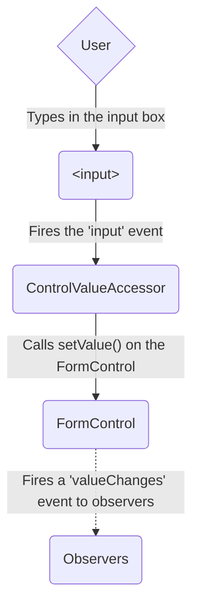
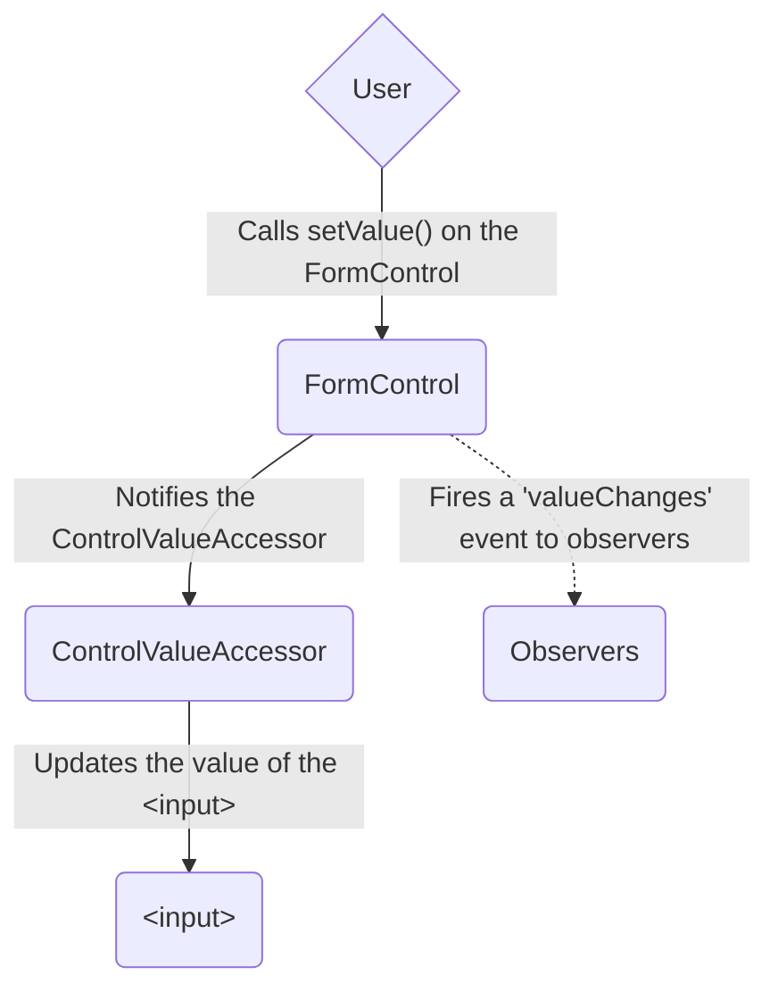
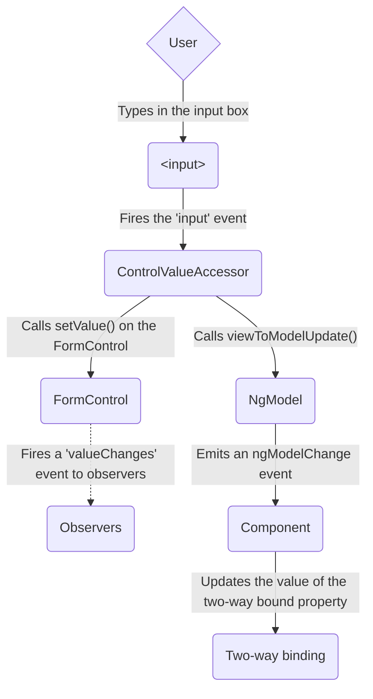
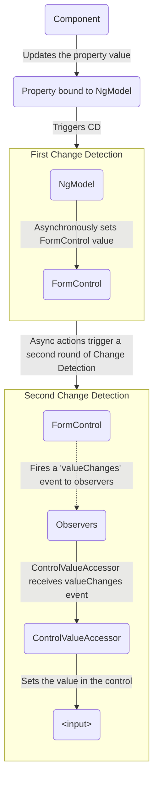

<docs-decorative-header title="Angular'da formalar" imgSrc="adev/src/assets/images/overview.svg"> <!-- markdownlint-disable-line -->
Formalar orqali foydalanuvchi kiritmalarini qayta ishlash koʻplab keng tarqalgan ilovalarning poydevoridir.
</docs-decorative-header>

Ilovalar formalardan foydalanuvchilarga tizimga kirish, profilni yangilash, maxfiy maʼlumotlarni kiritish va boshqa koʻplab maʼlumot kiritish vazifalarini bajarish imkonini berish uchun foydalanadi.

Angular formalar orqali foydalanuvchi kiritmalarini qayta ishlashning ikki xil yondashuvini taqdim etadi: reaktiv va shablonga asoslangan.

Ikkalasi ham view'dan foydalanuvchi kiritish hodisalarini ushlaydi, kiritmani validatsiya qiladi, forma va maʼlumotlar modelini yaratadi va oʻzgarishlarni kuzatish usulini taqdim etadi.

TIP: Agar yangi Signal Forms'ni izlayotgan boʻlsangiz, [Signal Forms boʻyicha asosiy qoʻllanmamizga](/essentials/signal-forms) qarang!

Ushbu qoʻllanma sizning vaziyatingiz uchun qaysi forma turi eng mos kelishini hal qilishga yordam beruvchi maʼlumotlarni taqdim etadi.
U ikkala yondashuvda ham qoʻllaniladigan umumiy qurilish bloklari bilan tanishtiradi.
Shuningdek, u ikki yondashuv oʻrtasidagi asosiy farqlarni umumlashtiradi va bu farqlarni sozlash, maʼlumotlar oqimi va testlash kontekstida koʻrsatib beradi.

## Yondashuvni tanlash {#choosing-an-approach}

Reaktiv formalar va shablonga asoslangan formalar forma maʼlumotlarini turlicha qayta ishlaydi va boshqaradi.
Har bir yondashuv oʻziga xos afzalliklarni taqdim etadi.

| Formalar                     | Tafsilotlar                                                                                                                                                                                                                                                                                                                                                                                                              |
| :--------------------------- | :----------------------------------------------------------------------------------------------------------------------------------------------------------------------------------------------------------------------------------------------------------------------------------------------------------------------------------------------------------------------------------------------------------------------- |
| Reaktiv formalar             | Asosiy forma obyekt modeliga toʻgʻridan-toʻgʻri, aniq (explicit) kirishni taqdim etadi. Shablonga asoslangan formalar bilan solishtirganda ular ancha mustahkam: ular yaxshiroq masshtablanadi, qayta foydalaniladi va testlanadi. Agar formalar ilovangizning asosiy qismi boʻlsa yoki ilovangizni qurishda allaqachon reaktiv namunalardan foydalanayotgan boʻlsangiz, reaktiv formalardan foydalaning.                 |
| Shablonga asoslangan formalar | Asosiy obyekt modelini yaratish va boshqarish uchun shablondagi direktivalarga tayanadi. Ular ilovaga oddiy forma, masalan, email roʻyxatiga obuna formasini qoʻshish uchun qulay. Ularni ilovaga qoʻshish oson, lekin ular reaktiv formalar kabi yaxshi masshtablanmaydi. Agar sizda juda oddiy forma talablari va faqat shablonning oʻzida boshqarish mumkin boʻlgan mantiq boʻlsa, shablonga asoslangan formalar yaxshi tanlov boʻlishi mumkin. |

### Asosiy farqlar {#key-differences}

Quyidagi jadval reaktiv va shablonga asoslangan formalar oʻrtasidagi asosiy farqlarni umumlashtiradi.

|                                                       | Reaktiv                                   | Shablonga asoslangan                  |
| :---------------------------------------------------- | :---------------------------------------- | :------------------------------------ |
| [Forma modelini sozlash](#setting-up-the-form-model)  | Aniq (explicit), komponent klassida yaratiladi | Bilvosita (implicit), direktivalar tomonidan yaratiladi |
| [Maʼlumotlar modeli](#mutability-of-the-data-model)   | Tuzilmali va oʻzgarmas (immutable)        | Tuzilmasiz va oʻzgaruvchan (mutable)  |
| [Maʼlumotlar oqimi](#data-flow-in-forms)              | Sinxron                                   | Asinxron                              |
| [Forma validatsiyasi](#form-validation)               | Funksiyalar                               | Direktivalar                          |

### Masshtablanuvchanlik {#scalability}

Agar formalar ilovangizning markaziy qismi boʻlsa, masshtablanuvchanlik juda muhim.
Forma modellarini komponentlar boʻylab qayta ishlata olish hal qiluvchi ahamiyatga ega.

Reaktiv formalar shablonga asoslangan formalarga qaraganda yaxshiroq masshtablanadi.
Ular asosiy forma API'siga toʻgʻridan-toʻgʻri kirishni taqdim etadi va view bilan maʼlumotlar modeli oʻrtasida [sinxron maʼlumotlar oqimidan](#data-flow-in-reactive-forms) foydalanadi, bu esa katta hajmdagi formalarni yaratishni osonlashtiradi.
Reaktiv formalar testlash uchun kamroq sozlashni talab qiladi, va forma yangilanishlari hamda validatsiyasini toʻgʻri testlash uchun oʻzgarishlarni aniqlashni chuqur tushunish talab etilmaydi.

Shablonga asoslangan formalar oddiy stsenariylarga qaratilgan va qayta foydalanish uchun unchalik qulay emas.
Ular asosiy forma API'sini abstraksiyalaydi va view bilan maʼlumotlar modeli oʻrtasida [asinxron maʼlumotlar oqimidan](#data-flow-in-template-driven-forms) foydalanadi.
Shablonga asoslangan formalarning abstraksiyasi testlashga ham taʼsir qiladi.
Testlar toʻgʻri ishlashi uchun oʻzgarishlarni aniqlashni qoʻlda ishga tushirishga kuchli bogʻliq boʻladi va koʻproq sozlashni talab qiladi.

## Forma modelini sozlash {#setting-up-the-form-model}

Reaktiv formalar ham, shablonga asoslangan formalar ham foydalanuvchilar oʻzaro aloqada boʻladigan forma input elementlari bilan komponent modelingizdagi forma maʼlumotlari oʻrtasidagi qiymat oʻzgarishlarini kuzatadi.
Ikkala yondashuv umumiy asosiy qurilish bloklariga ega, lekin umumiy forma kontrol (form-control) nusxalarini qanday yaratish va boshqarishingiz bilan farqlanadi.

### Umumiy forma asos klasslari {#common-form-foundation-classes}

Reaktiv formalar ham, shablonga asoslangan formalar ham quyidagi asos klasslar ustiga qurilgan.

| Asos klasslar          | Tafsilotlar                                                                             |
| :--------------------- | :-------------------------------------------------------------------------------------- |
| `FormControl`          | Alohida forma kontrolining qiymati va validatsiya holatini kuzatadi.                    |
| `FormGroup`            | Forma kontrollari toʻplami uchun xuddi shu qiymatlar va holatni kuzatadi.               |
| `FormArray`            | Forma kontrollari massivi uchun xuddi shu qiymatlar va holatni kuzatadi.                |
| `ControlValueAccessor` | Angular `FormControl` nusxalari bilan oʻrnatilgan DOM elementlari oʻrtasida koʻprik yaratadi. |

### Reaktiv formalarda sozlash {#setup-in-reactive-forms}

Reaktiv formalarda forma modelini toʻgʻridan-toʻgʻri komponent klassida aniqlaysiz.
`[formControl]` direktivasi aniq yaratilgan `FormControl` nusxasini ichki qiymat accessor'i yordamida view'dagi maʼlum forma elementiga bogʻlaydi.

Quyidagi komponent reaktiv formalardan foydalanib, bitta kontrol uchun input maydonini amalga oshiradi.
Bu misolda forma modeli `FormControl` nusxasidir.

<docs-code language="angular-ts" path="adev/src/content/examples/forms-overview/src/app/reactive/favorite-color/favorite-color.component.ts"/>

IMPORTANT: Reaktiv formalarda forma modeli haqiqat manbai (source of truth) hisoblanadi; u `<input>` elementidagi `[formControl]` direktivasi orqali forma elementining qiymati va holatini istalgan vaqtda taqdim etadi.

### Shablonga asoslangan formalarda sozlash {#setup-in-template-driven-forms}

Shablonga asoslangan formalarda forma modeli aniq emas, balki bilvosita boʻladi.
`NgModel` direktivasi berilgan forma elementi uchun `FormControl` nusxasini yaratadi va boshqaradi.

Quyidagi komponent shablonga asoslangan formalardan foydalanib, bitta kontrol uchun xuddi shu input maydonini amalga oshiradi.

<docs-code language="angular-ts" path="adev/src/content/examples/forms-overview/src/app/template/favorite-color/favorite-color.component.ts"/>

IMPORTANT: Shablonga asoslangan formada haqiqat manbai shablondir. `NgModel` direktivasi `FormControl` nusxasini siz uchun avtomatik boshqaradi.

## Formalarda maʼlumotlar oqimi {#data-flow-in-forms}

Ilovada forma boʻlsa, Angular view'ni komponent modeli bilan, komponent modelini esa view bilan sinxron holatda saqlashi kerak.
Foydalanuvchilar view orqali qiymatlarni oʻzgartirib, tanlovlar qilganda, yangi qiymatlar maʼlumotlar modelida aks etishi kerak.
Shunga oʻxshab, dastur mantigʻi maʼlumotlar modelidagi qiymatlarni oʻzgartirganda, bu qiymatlar view'da aks etishi kerak.

Reaktiv va shablonga asoslangan formalar foydalanuvchidan yoki dasturiy oʻzgarishlardan keladigan maʼlumotlar oqimini qayta ishlash usuli bilan farqlanadi.
Quyidagi diagrammalar yuqorida aniqlangan sevimli rang (favorite-color) input maydonidan foydalanib, har bir forma turi uchun ikkala turdagi maʼlumotlar oqimini koʻrsatadi.

### Reaktiv formalarda maʼlumotlar oqimi {#data-flow-in-reactive-forms}

Reaktiv formalarda view'dagi har bir forma elementi forma modeliga (`FormControl` nusxasiga) toʻgʻridan-toʻgʻri bogʻlangan.
View'dan modelga va modeldan view'ga yangilanishlar sinxron boʻlib, UI qanday render qilinishiga bogʻliq emas.

View'dan modelga diagrammasi input maydonining qiymati view'dan oʻzgartirilganda maʼlumotlar quyidagi qadamlar orqali qanday oqishini koʻrsatadi:

1. Foydalanuvchi input elementiga qiymat kiritadi, bu holda sevimli rang _Blue_.
1. Forma input elementi eng soʻnggi qiymat bilan "input" hodisasini chiqaradi.
1. Forma input elementidagi hodisalarni tinglayotgan `ControlValueAccessor` yangi qiymatni darhol `FormControl` nusxasiga uzatadi.
1. `FormControl` nusxasi yangi qiymatni `valueChanges` observable'i orqali chiqaradi.
1. `valueChanges` observable'ining barcha obunachilari yangi qiymatni oladi.

Modeldan view'ga diagrammasi modeldagi dasturiy oʻzgarish view'ga quyidagi qadamlar orqali qanday tarqalishini koʻrsatadi.

1. Foydalanuvchi `favoriteColorControl.setValue()` metodini chaqiradi, bu `FormControl` qiymatini yangilaydi.
1. `FormControl` nusxasi yangi qiymatni `valueChanges` observable'i orqali chiqaradi.
1. `valueChanges` observable'ining barcha obunachilari yangi qiymatni oladi.
1. Forma input elementidagi kontrol qiymat accessor'i elementni yangi qiymat bilan yangilaydi.

### Shablonga asoslangan formalarda maʼlumotlar oqimi {#data-flow-in-template-driven-forms}

Shablonga asoslangan formalarda har bir forma elementi forma modelini ichki boshqaradigan direktivaga bogʻlangan.

View'dan modelga diagrammasi input maydonining qiymati view'dan oʻzgartirilganda maʼlumotlar quyidagi qadamlar orqali qanday oqishini koʻrsatadi.

1. Foydalanuvchi input elementiga _Blue_ kiritadi.
1. Input elementi _Blue_ qiymati bilan "input" hodisasini chiqaradi.
1. Input'ga biriktirilgan kontrol qiymat accessor'i `FormControl` nusxasidagi `setValue()` metodini ishga tushiradi.
1. `FormControl` nusxasi yangi qiymatni `valueChanges` observable'i orqali chiqaradi.
1. `valueChanges` observable'ining barcha obunachilari yangi qiymatni oladi.
1. Kontrol qiymat accessor'i shuningdek `NgModel.viewToModelUpdate()` metodini chaqiradi, bu esa `ngModelChange` hodisasini chiqaradi.
1. Komponent shabloni `favoriteColor` xususiyati uchun ikki tomonlama maʼlumot bogʻlashdan foydalangani sababli, komponentdagi `favoriteColor` xususiyati `ngModelChange` hodisasi chiqargan qiymatga \(_Blue_\) yangilanadi.

Modeldan view'ga diagrammasi `favoriteColor` _Blue_'dan _Red_'ga oʻzgarganda maʼlumotlar modeldan view'ga quyidagi qadamlar orqali qanday oqishini koʻrsatadi

1. `favoriteColor` qiymati komponentda yangilanadi.
1. Oʻzgarishlarni aniqlash boshlanadi.
1. Oʻzgarishlarni aniqlash davomida `NgModel` direktivasi nusxasida `ngOnChanges` hayot sikli hook'i chaqiriladi, chunki uning input'laridan birining qiymati oʻzgargan.
1. `ngOnChanges()` metodi ichki `FormControl` nusxasi uchun qiymatni oʻrnatuvchi asinxron vazifani navbatga qoʻyadi.
1. Oʻzgarishlarni aniqlash yakunlanadi.
1. Keyingi tick'da `FormControl` nusxasi qiymatini oʻrnatish vazifasi bajariladi.
1. `FormControl` nusxasi eng soʻnggi qiymatni `valueChanges` observable'i orqali chiqaradi.
1. `valueChanges` observable'ining barcha obunachilari yangi qiymatni oladi.
1. Kontrol qiymat accessor'i view'dagi forma input elementini eng soʻnggi `favoriteColor` qiymati bilan yangilaydi.

NOTE: `NgModel` `ExpressionChangedAfterItHasBeenChecked` xatolaridan qochish uchun ikkinchi oʻzgarishlarni aniqlashni ishga tushiradi, chunki qiymat oʻzgarishi input bogʻlashidan kelib chiqadi.

### Maʼlumotlar modelining oʻzgaruvchanligi {#mutability-of-the-data-model}

Oʻzgarishlarni kuzatish usuli ilovangizning samaradorligida rol oʻynaydi.

| Formalar                     | Tafsilotlar                                                                                                                                                                                                                                                                                                                                                                                                                                                                                                                                              |
| :--------------------------- | :------------------------------------------------------------------------------------------------------------------------------------------------------------------------------------------------------------------------------------------------------------------------------------------------------------------------------------------------------------------------------------------------------------------------------------------------------------------------------------------------------------------------------------------------------- |
| Reaktiv formalar             | Maʼlumotlar modelini oʻzgarmas (immutable) maʼlumotlar tuzilmasi sifatida taqdim etib, uni toza saqlaydi. Maʼlumotlar modelida har safar oʻzgarish ishga tushganda `FormControl` nusxasi mavjud maʼlumotlar modelini yangilash oʻrniga yangi maʼlumotlar modelini qaytaradi. Bu sizga kontrolning observable'i orqali maʼlumotlar modelidagi noyob oʻzgarishlarni kuzatish imkonini beradi. Oʻzgarishlarni aniqlash samaraliroq, chunki u faqat noyob oʻzgarishlarda yangilanishi kerak. Maʼlumot yangilanishlari reaktiv namunalarga amal qilgani sababli, maʼlumotlarni oʻzgartirish uchun observable operatorlari bilan integratsiya qilishingiz mumkin. |
| Shablonga asoslangan formalar | Shablonda oʻzgarishlar kiritilganda komponentdagi maʼlumotlar modelini yangilash uchun ikki tomonlama maʼlumot bogʻlash bilan oʻzgaruvchanlikka (mutability) tayanadi. Ikki tomonlama maʼlumot bogʻlashdan foydalanilganda maʼlumotlar modelida kuzatish uchun noyob oʻzgarishlar boʻlmagani sababli, oʻzgarishlarni aniqlash yangilanishlar qachon zarurligini aniqlashda kamroq samarali boʻladi.                                                                                                                                                              |

Bu farq sevimli rang input elementidan foydalanadigan oldingi misollarda koʻrsatilgan.

- Reaktiv formalarda **`FormControl` nusxasi** kontrol qiymati yangilanganda har doim yangi qiymat qaytaradi
- Shablonga asoslangan formalarda **sevimli rang xususiyati** har doim oʻzining yangi qiymatiga oʻzgartiriladi

## Forma validatsiyasi {#form-validation}

Validatsiya har qanday formalar toʻplamini boshqarishning ajralmas qismidir.
Majburiy maydonlarni tekshirayotgan boʻlasizmi yoki mavjud foydalanuvchi nomini tashqi API'dan soʻrayotgan boʻlasizmi, Angular oʻrnatilgan validatorlar toʻplamini, shuningdek maxsus validatorlar yaratish imkoniyatini taqdim etadi.

| Formalar                     | Tafsilotlar                                                                                                              |
| :--------------------------- | :----------------------------------------------------------------------------------------------------------------------- |
| Reaktiv formalar             | Maxsus validatorlarni validatsiya qilinadigan kontrolni qabul qiluvchi **funksiyalar** sifatida aniqlaydi                 |
| Shablonga asoslangan formalar | Shablon **direktivalariga** bogʻlangan va validatsiya funksiyalarini oʻrab turuvchi maxsus validator direktivalarini taqdim etishi kerak |

Koʻproq maʼlumot uchun [Forma validatsiyasi](guide/forms/form-validation#validating-input-in-reactive-forms) boʻlimiga qarang.

## Testlash {#testing}

Testlash murakkab ilovalarda katta rol oʻynaydi.
Formalaringiz toʻgʻri ishlashini tekshirishda soddaroq testlash strategiyasi foydali boʻladi.
Reaktiv formalar va shablonga asoslangan formalar forma kontroli va forma maydoni oʻzgarishlariga asoslangan tekshiruvlarni (assertion) bajarish uchun UI render qilishga turli darajada bogʻliq.
Quyidagi misollar reaktiv va shablonga asoslangan formalar bilan formalarni testlash jarayonini koʻrsatadi.

### Reaktiv formalarni testlash {#testing-reactive-forms}

Reaktiv formalar nisbatan sodda testlash strategiyasini taqdim etadi, chunki ular forma va maʼlumotlar modellariga sinxron kirishni taʼminlaydi va UI'ni render qilmasdan testlanishi mumkin.
Bu testlarda holat va maʼlumotlar oʻzgarishlarni aniqlash sikli bilan oʻzaro aloqa qilmasdan, kontrol orqali soʻraladi va boshqariladi.

Quyidagi testlar reaktiv forma uchun view'dan modelga va modeldan view'ga maʼlumotlar oqimlarini tekshirish uchun oldingi misollardagi sevimli rang komponentlaridan foydalanadi.

<!--todo: make consistent with other topics -->

#### View'dan modelga maʼlumotlar oqimini tekshirish {#verifying-view-to-model-data-flow}

Birinchi misol view'dan modelga maʼlumotlar oqimini tekshirish uchun quyidagi qadamlarni bajaradi.

1. View'dan forma input elementini soʻrang va test uchun maxsus "input" hodisasini yarating.
1. Input uchun yangi qiymatni _Red_ ga oʻrnating va forma input elementida "input" hodisasini joʻnating (dispatch).
1. Komponentning `favoriteColorControl` qiymati input'dagi qiymatga mos kelishini tekshiring.

<docs-code header="Sevimli rang testi - view'dan modelga" path="adev/src/content/examples/forms-overview/src/app/reactive/favorite-color/favorite-color.component.spec.ts" region="view-to-model"/>

Keyingi misol modeldan view'ga maʼlumotlar oqimini tekshirish uchun quyidagi qadamlarni bajaradi.

1. Yangi qiymatni oʻrnatish uchun `FormControl` nusxasi boʻlgan `favoriteColorControl`'dan foydalaning.
1. View'dan forma input elementini soʻrang.
1. Kontrolda oʻrnatilgan yangi qiymat input'dagi qiymatga mos kelishini tekshiring.

<docs-code header="Sevimli rang testi - modeldan view'ga" path="adev/src/content/examples/forms-overview/src/app/reactive/favorite-color/favorite-color.component.spec.ts" region="model-to-view"/>

### Shablonga asoslangan formalarni testlash {#testing-template-driven-forms}

Shablonga asoslangan formalar bilan testlar yozish elementlar toʻgʻri vaqtda soʻralishi, testlanishi yoki oʻzgartirilishini taʼminlash uchun oʻzgarishlarni aniqlash jarayonini batafsil bilishni va direktivalar har bir siklda qanday ishlashini tushunishni talab qiladi.

Quyidagi testlar shablonga asoslangan forma uchun view'dan modelga va modeldan view'ga maʼlumotlar oqimlarini tekshirish uchun avval aytib oʻtilgan sevimli rang komponentlaridan foydalanadi.

Quyidagi test view'dan modelga maʼlumotlar oqimini tekshiradi.

<docs-code header="Sevimli rang testi - view'dan modelga" path="adev/src/content/examples/forms-overview/src/app/template/favorite-color/favorite-color.component.spec.ts" region="view-to-model"/>

View'dan modelga testida bajariladigan qadamlar quyidagilar.

1. View'dan forma input elementini soʻrang va test uchun maxsus "input" hodisasini yarating.
1. Input uchun yangi qiymatni _Red_ ga oʻrnating va forma input elementida "input" hodisasini joʻnating.
1. Test fixture orqali oʻzgarishlarni aniqlashni ishga tushiring.
1. Komponentning `favoriteColor` xususiyati qiymati input'dagi qiymatga mos kelishini tekshiring.

Quyidagi test modeldan view'ga maʼlumotlar oqimini tekshiradi.

<docs-code header="Sevimli rang testi - modeldan view'ga" path="adev/src/content/examples/forms-overview/src/app/template/favorite-color/favorite-color.component.spec.ts" region="model-to-view"/>

Modeldan view'ga testida bajariladigan qadamlar quyidagilar.

1. `favoriteColor` xususiyati qiymatini oʻrnatish uchun komponent nusxasidan foydalaning.
1. Test fixture orqali oʻzgarishlarni aniqlashni ishga tushiring.
1. Keyingi render qilishni kutish uchun `await fixture.whenStable()`'dan foydalaning.
1. View'dan forma input elementini soʻrang.
1. Input qiymati komponent nusxasidagi `favoriteColor` xususiyati qiymatiga mos kelishini tekshiring.

## Keyingi qadamlar {#next-steps}

Reaktiv formalar haqida koʻproq bilish uchun quyidagi qoʻllanmalarga qarang:

<docs-pill-row>
  <docs-pill href="guide/forms/reactive-forms" title="Reaktiv formalar"/>
  <docs-pill href="guide/forms/form-validation#validating-input-in-reactive-forms" title="Forma validatsiyasi"/>
  <docs-pill href="guide/forms/dynamic-forms" title="Dinamik formalar"/>
</docs-pill-row>

Shablonga asoslangan formalar haqida koʻproq bilish uchun quyidagi qoʻllanmalarga qarang:

<docs-pill-row>
  <docs-pill href="guide/forms/template-driven-forms" title="Shablonga asoslangan formalar darsligi" />
  <docs-pill href="guide/forms/form-validation#validating-input-in-template-driven-forms" title="Forma validatsiyasi" />
  <docs-pill href="api/forms/NgForm" title="NgForm direktivasi API maʼlumotnomasi" />
</docs-pill-row>
