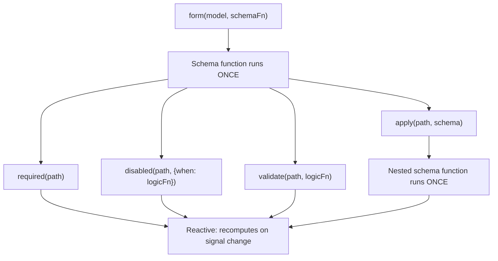

# Sxemalar va sxema kompozitsiyasi

Signal Forms _formangiz qanday tuzilganini_ _u ish vaqtida qanday ishlashidan_ ajratish uchun ikki qatlamli arxitekturadan foydalanadi.

`form()`'ga sxema funksiyasini uzatganingizda, bu funksiya forma yaratilishi davomida _bir marta ishlaydi_. Uning vazifasi — qaysi maydonlar validatsiyaga ega, qaysi maydonlar oʻchirilgan va qaysi maydonlar boshqa maydonlarga bogʻliq ekanini eʼlon qilish orqali formaning mantiq daraxtini sozlash. Bu formangizning **strukturaviy qatlami**.

Sxema funksiyasi ichida `disabled()` va `validate()` kabi qoida funksiyalarini chaqirasiz. Bu qoida funksiyalari oʻzlari murojaat qilgan signallar oʻzgarganda qayta hisoblanuvchi reaktiv mantiqni qabul qiladi. `disabled()` va `required()` kabi shartli qoidalar ixtiyoriy konfiguratsiyani, shu jumladan qoidani faollashtiruvchi `when` funksiyasini qabul qiladi. Bular birgalikda ish vaqtida formangizning **xatti-harakat qatlamini** tashkil qiladi.

```ts
contactForm = form(this.contactModel, (schemaPath) => {
  // Schema function: runs ONCE during form creation
  required(schemaPath.name);
  disabled(schemaPath.couponCode, {when: ({valueOf}) => valueOf(schemaPath.total) < 50});
  //  ^^^ Reactive logic: recomputes when total changes
});
```



Bu farq sxemalarni kompozitsiya qilganingizda muhim, chunki `apply()`, `applyWhen()` va `schema()` kabi funksiyalarning barchasi strukturaviy qatlamda ishlaydi. Sxemalar _qaysi_ qoidalar mavjudligini va ular faol _yoki faol emasligini_ boshqaradi, qoida funksiyalari esa bu qoidalar _nimani_ baholashini belgilaydi.

## `schema()` bilan qayta ishlatiladigan sxemalar yaratish {#create-reusable-schemas-with-schema}

Bir nechta forma umumiy maʼlumotlar shakli uchun bir xil qoidalarni baham koʻrganda, bu qoidalarni qayta ishlatiladigan sxemaga ajratib olish uchun `schema()` funksiyasidan foydalanishingiz mumkin.

```ts
import {schema, required, minLength} from '@angular/forms/signals';

const nameSchema = schema<{first: string; last: string}>((name) => {
  required(name.first);
  required(name.last);
  minLength(name.first, 2);
  minLength(name.last, 2);
});
```

`schema()` funksiyasi funksiyani oʻrab, uni qayta ishlatiladigan `Schema<T>` obyektiga aylantiradi. Istalgan sxema funksiyasi kabi, u har bir forma uchun _bir marta ishlaydi_, lekin obyektning oʻzi sizga kerak boʻlgan istalgancha forma oʻrtasida baham koʻrilishi mumkin.

TIP: Agar qoidalar faqat bir joyda uchrasa, inline sxema funksiyasi ham xuddi shunday yaxshi ishlaydi. `schema()`'dan bir xil sxemani bir nechta formada qayta ishlatmoqchi yoki bir xil sxemani bir nechta yoʻlga qoʻllamoqchi boʻlganingizda foydalaning. Qayta ishlatiladigan `Schema` obyektlari har bir forma kompilyatsiyasi uchun keshlanadi.

### Sxemani `apply()` bilan ishlatish {#using-the-schema-with-apply}

`apply()` funksiyasidan foydalanib, qayta ishlatiladigan sxemani formadagi muayyan yoʻlga qoʻllashingiz mumkin. `apply()`'ni chaqirganingizda sxema faqat shu ichki yoʻl doirasidagi maydonlarni koʻradigan cheklangan (scoped) yoʻlni qabul qiladi:

```ts
import {apply} from '@angular/forms/signals';

profileForm = form(this.profileModel, (schemaPath) => {
  apply(schemaPath.name, nameSchema);
});

registrationForm = form(this.registrationModel, (schemaPath) => {
  apply(schemaPath.name, nameSchema);
});
```

## `applyWhen()` bilan shartli sxemalar {#conditional-schemas-with-applywhen}

NOTE: [Forma mantigʻini qoʻshish qoʻllanmasi](guide/forms/signals/form-logic) inline mantiqli shartli qoidalar uchun `applyWhen()`'ni tanishtirgan edi. Bu boʻlim `applyWhen()`'ni qayta ishlatiladigan sxemalar bilan qanday kompozitsiya qilishni yoritadi.

Baʼzi qoidalar faqat maʼlum shartlarda qoʻllanishi kerak. Masalan, pochta indeksi maydoni validatsiyani faqat tanlangan davlat Amerika Qoʻshma Shtatlari boʻlganda talab qilishi mumkin.

`applyWhen()` funksiyasi sxemani reaktiv holatga asoslanib shartli qoʻllaydi. U uchta argument qabul qiladi:

1. Sxema qoʻllanadigan yoʻl
1. Sxema faol boʻlishi kerak boʻlganda `true` qaytaruvchi reaktiv mantiq funksiyasi
1. Shartli qoidalarni oʻz ichiga olgan sxema yoki sxema funksiyasi

```ts
import {form, applyWhen, required, pattern} from '@angular/forms/signals';

addressForm = form(this.addressModel, (schemaPath) => {
  applyWhen(
    schemaPath,
    ({valueOf}) => valueOf(schemaPath.country) === 'US',
    (schemaPath) => {
      required(schemaPath.zipCode);
      pattern(schemaPath.zipCode, /^\d{5}(-\d{4})?$/);
    },
  );
});
```

Mantiq funksiyasi `value`, `valueOf`, `stateOf` va boshqa reaktiv yordamchilarga murojaat qilish imkonini beruvchi `FieldContext`'ni qabul qiladi. U reaktiv boʻlgani uchun, shart oʻqigan signallar oʻzgarganda qayta hisoblanadi. Shart `false` boʻlganda sxema ichidagi qoidalar faolsizlanadi. Yana `true` boʻlganda ular qayta faollashadi.

Sxemaning oʻzi hamon strukturaviy — sxema funksiyasi forma yaratilishi davomida bir marta ishlaydi. Shart bu qoidalar _mavjudligini_ emas, _faolligini_ boshqaradi.

Shartli sxema ichida shu sxema funksiyasiga uzatilgan cheklangan yoʻl parametridan foydalaning. Tashqi sxemadagi yoʻllar ichki sxema ichida yaroqli emas.

### `applyWhen()`'ni qayta ishlatiladigan sxemalar bilan birlashtirish {#combining-applywhen-with-reusable-schemas}

`applyWhen()` `Schema` obyektini qabul qilgani uchun, qayta ishlatiladigan sxemalarni shartli qoʻllash uchun uni `schema()` bilan juftlashtirishingiz mumkin:

```ts
const usZipCodeSchema = schema<{zipCode: string}>((address) => {
  required(address.zipCode);
  pattern(address.zipCode, /^\d{5}(-\d{4})?$/);
});

const caPostalCodeSchema = schema<{postalCode: string}>((address) => {
  required(address.postalCode);
  pattern(address.postalCode, /^[A-Z]\d[A-Z] \d[A-Z]\d$/);
});

shippingForm = form(this.shippingModel, (schemaPath) => {
  applyWhen(
    schemaPath.address,
    ({valueOf}) => valueOf(schemaPath.country) === 'US',
    usZipCodeSchema,
  );
  applyWhen(
    schemaPath.address,
    ({valueOf}) => valueOf(schemaPath.country) === 'CA',
    caPostalCodeSchema,
  );
});
```

NOTE: Yoʻl argumenti `schemaPath.address` boʻlsa ham, mantiq funksiyasi `valueOf(schemaPath.country)`'ga murojaat qiladi. Buning sababi — `valueOf` yordamchisi faqat cheklangan yoʻl doirasidagi maydonlarga emas, formadagi istalgan maydonga murojaat qila oladi.

Bu namuna validatsiya mantigʻini modulli saqlaydi — har bir davlatning manzil qoidalari oʻz sxemasida joylashadi va forma foydalanuvchi tanloviga asoslanib qaysi birini faollashtirishni tanlaydi.

## `applyWhenValue()` bilan turni toraytirish {#type-narrowing-with-applywhenvalue}

`applyWhenValue()` funksiyasi faqat maydon qiymatini tekshirishi kerak boʻlgan shartlarni soddalashtiradi. Shart funksiyasi `FieldContext` oʻrniga maydonning xom qiymatini bevosita qabul qiladi.

```ts {header: "applyWhen — logic function receives FieldContext"}
applyWhen(schemaPath.payment, ({value}) => value().type === 'credit-card', creditCardSchema);
```

```ts {header: "applyWhenValue — condition receives the value directly"}
applyWhenValue(schemaPath.payment, (payment) => payment.type === 'credit-card', creditCardSchema);
```

`applyWhenValue()`'ning asosiy afzalligi — TypeScript turini himoyalovchi (type guard) funksiyalarni qoʻllab-quvvatlashi. Shart funksiyasi type guard boʻlganda, sxemaning tur parametri himoyalangan turga torayadi. Bu, ayniqsa, har bir varianti turli qoidalar talab qiluvchi turli maydonlarga ega boʻlgan diskriminatsiyalangan birlashmalar (discriminated union) uchun foydali.

```ts
import {form, applyWhenValue, required} from '@angular/forms/signals';

interface CreditCard {
  type: 'credit-card';
  cardNumber: string;
  expiry: string;
  cvv: string;
}

interface BankTransfer {
  type: 'bank-transfer';
  accountNumber: string;
  routingNumber: string;
}

type PaymentMethod = CreditCard | BankTransfer;

function isCreditCard(value: PaymentMethod): value is CreditCard {
  return value.type === 'credit-card';
}

function isBankTransfer(value: PaymentMethod): value is BankTransfer {
  return value.type === 'bank-transfer';
}

paymentForm = form(this.paymentModel, (schemaPath) => {
  applyWhenValue(schemaPath, isCreditCard, (payment) => {
    // TypeScript knows payment is scoped to CreditCard
    required(payment.cardNumber);
    required(payment.expiry);
    required(payment.cvv);
  });

  applyWhenValue(schemaPath, isBankTransfer, (payment) => {
    // TypeScript knows payment is scoped to BankTransfer
    required(payment.accountNumber);
    required(payment.routingNumber);
  });
});
```

Type guard'siz TypeScript har bir sxema funksiyasi ichida qaysi maydonlar mavjudligini bilmagan boʻlardi. Turni toraytirish kredit karta tarmogʻida `payment.cardNumber`'ga, bank oʻtkazmasi tarmogʻida esa `payment.accountNumber`'ga murojaat qilish tur jihatidan xavfsiz boʻlishini taʼminlaydi.

## `applyEach()` bilan massiv elementlari {#array-items-with-applyeach}

Forma obyektlar massivini oʻz ichiga olganda, koʻpincha har bir elementga bir xil qoidalarni qoʻllash kerak boʻladi. `applyEach()` funksiyasi massiv maydonidagi har bir elementga, elementlar soni qancha boʻlishidan qatʼi nazar, sxemani qoʻllaydi.

```ts
import {form, applyEach, required, min} from '@angular/forms/signals';

type LineItem = {name: string; quantity: number};

orderForm = form(this.orderModel, (schemaPath) => {
  required(schemaPath.title);

  applyEach(schemaPath.items, (item) => {
    required(item.name);
    min(item.quantity, 1);
  });
});
```

`applyEach()`'ga uzatilgan sxema funksiyasi bitta massiv elementi bilan cheklangan `SchemaPathTree`'ni qabul qiladi. Ichida eʼlon qilingan qoidalar massivdagi har bir elementga, shu jumladan forma yaratilgandan keyin qoʻshilgan elementlarga ham qoʻllanadi.

### `applyEach()`'ni qayta ishlatiladigan sxemalar bilan birlashtirish {#combining-applyeach-with-reusable-schemas}

`applyEach()` `Schema` obyektini qabul qilgani uchun, element darajasidagi qoidalarni qayta ishlatiladigan sxemaga ajratib olib, ularni formalar oʻrtasida baham koʻrishingiz mumkin:

```ts
const lineItemSchema = schema<LineItem>((item) => {
  required(item.name);
  min(item.quantity, 1);
});

orderForm = form(this.orderModel, (schemaPath) => {
  required(schemaPath.title);
  applyEach(schemaPath.items, lineItemSchema);
});

invoiceForm = form(this.invoiceModel, (schemaPath) => {
  required(schemaPath.invoiceNumber);
  applyEach(schemaPath.lineItems, lineItemSchema);
});
```

TIP: Massiv elementlarini validatsiya qilish, shu jumladan har bir maydon uchun maxsus xato xabarlari haqida koʻproq bilish uchun [Validatsiya boʻyicha qoʻllanma](guide/forms/signals/validation) bilan tanishing.

## Keyingi qadamlar {#next-steps}

Signal Forms haqida koʻproq bilish uchun quyidagi tegishli qoʻllanmalarni koʻrib chiqing:

- [Forma mantigʻini qoʻshish](guide/forms/signals/form-logic) - Formalaringizga shartli mantiq, dinamik xatti-harakat va metamaʼlumotlar qoʻshishni oʻrganing
- [Validatsiya](guide/forms/signals/validation) - Validatsiya qoidalari va xatolarni qayta ishlash haqida bilib oling
- [Asinxron operatsiyalar](guide/forms/signals/async-operations) - Forma yuborish va asinxron validatsiyani qayta ishlashni oʻrganing
